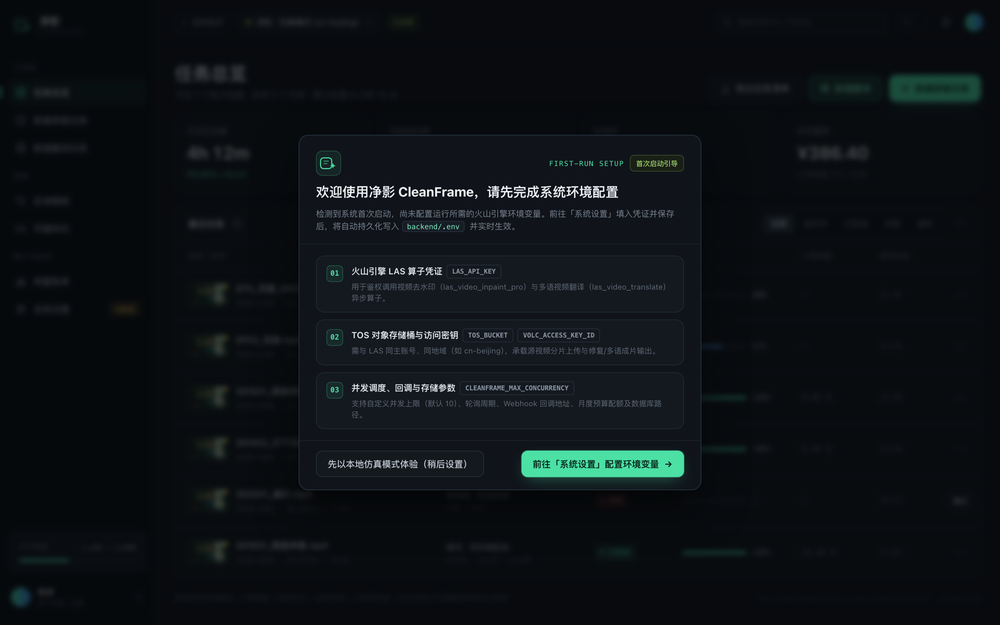
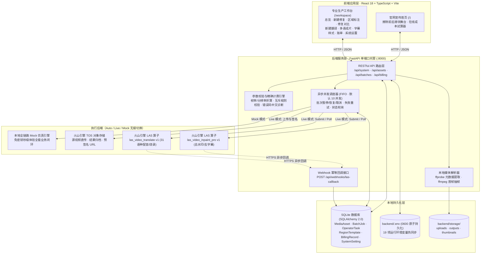

<div align="center">


# 净影 CleanFrame

**开源 AI 视频去水印、硬字幕无痕擦除与 31 语种视频翻译烧录一体化工作台**

*Open-Source AI Video Watermark Remover, Hardcoded Subtitle Eraser & 31-Language Video Localization Studio*

[](https://erasevid.com/?utm_source=github&utm_medium=readme_zh)
[](https://www.python.org/)
[](https://fastapi.tiangolo.com/)
[](https://react.dev/)
[](https://www.typescriptlang.org/)
[](https://www.volcengine.com/)
[](#5-分钟快速开始)
[](https://github.com/xuliang2024/video-watermark-remover/stargazers)

<p align="center">
  <strong>简体中文</strong> ·
  <a href="./docs/i18n/README.en.md">English</a> ·
  <a href="./docs/i18n/README.ja.md">日本語</a> ·
  <a href="./docs/i18n/README.ko.md">한국어</a> ·
  <a href="./docs/i18n/README.es.md">Español</a> ·
  <a href="./docs/i18n/README.ru.md">Русский</a>
</p>

<p align="center">
  <a href="https://erasevid.com/?utm_source=github&utm_medium=readme_zh"><strong>🚀 在线商业云工作台（EraseVid.com · 免部署即用）</strong></a> ·
  <a href="#项目简介">项目简介</a> ·
  <a href="#核心能力亮点">核心亮点</a> ·
  <a href="#界面与效果预览">界面预览</a> ·
  <a href="#系统架构与技术栈">系统架构</a> ·
  <a href="#5-分钟快速开始">快速开始</a> ·
  <a href="#19-项环境变量参考">环境变量</a> ·
  <a href="#算子规格与计费折算公式">算子与语种</a> ·
  <a href="#rest-api-速查表">API 文档</a> ·
  <a href="#常见问题faq">FAQ</a>
</p>

> **不想自备服务器或申请配置云厂商 API 密钥？** 立即访问官方托管云工作台 👉 **[https://erasevid.com](https://erasevid.com/?utm_source=github&utm_medium=readme_zh)** —— 零运维开箱即用、团队多成员协作、按量透明计费（异常任务自动全额退费），注册新团队即赠体验金。


</div>

---

## 项目简介

**净影 CleanFrame** 是一套面向**短剧出海团队、跨境电商卖家、MCN 机构、在线教育团队及独立创作者**构建的开源批量视频后制工作台。系统底层深度对接火山引擎大模型数据算子（`las_video_inpaint_pro v1` 视频去水印/字幕擦除算子与 `las_video_translate v1` 多语种视频翻译配音算子），前端提供影视后期级暗色工作台，实现从**本地视频批量上传、画布级固定框标注、无痕去水印与去硬字幕，到 31 语种原声复刻配音与字幕重烧录**的一站式自动化流水线。

> **免密钥即刻体验（Zero-Key Local Mock）**：无需预先开通任何云端凭证，克隆仓库后执行 `./start.sh` 即可启动**本地全链路仿真模式**，完整体验多批次调度、1000×1000 归一化框选标注、修复前后滑块对比、多语字幕对照、在线成本试算等全部界面能力；在工作台「系统设置」填入火山引擎 LAS / TOS 凭证后，无需改代码即可热切换至 `Live` 生产算子模式。

### 解决什么痛点？

| 传统视频去水印与出海本地化流程 | 净影 CleanFrame 一体化工作流 |
| :--- | :--- |
| 单集手动在剪辑软件中打高斯模糊或裁剪画面，破坏构图且效率极低 | **AI 时空上下文像素级重绘修复**，无痕擦除动态台标、角标、底部硬字幕与跑马灯，100% 保留原始画幅与音轨 |
| 整季 80~120 集短剧逐集重复框选同一角标位置，人工易漏标、误擦人脸 | **1000×1000 归一化画布区域模板**，支持多框 + 独立起止时间段，一键保存模板并批量套用至整季全集 |
| 去字幕、多语翻译、TTS 配音、压制字幕分散在 4~5 个工具之间来回导片 | **「先去水印擦原字幕 → 再多语配音烧录」单管线串联**，同一干净母带复用于全部目标语种，当天完成全球分发 |
| 50/60fps 高帧率素材盲目提交云端 API，导致单集账单翻倍才后知后觉 | **提交前逐文件精确算费 + 高帧率自动预警**，智能建议 30fps 输出封顶直省 50% 成本，预算透明可控 |
| 云厂商 SDK 参数繁杂、缺少队列重试、TOS 签名与异步回调需从零搭后台 | **内置 10 并发异步 FIFO 调度器 + Webhook 幂等回调 + 可视化配置中心**，单端口开箱即用 |

---

## 核心能力亮点

### 1. 智能视频无痕去水印与硬字幕擦除（`las_video_inpaint_pro v1`）
- **四类擦除目标正交组合**：支持自由勾选 `水印 / 角标 / Logo`、`普通底部硬字幕`、`顶部/底部滚动字幕`、`片头剧集信息`。
- **三种定位策略按需切换**：
  - **专业版 · 精准识别（`precise`）**：视觉大模型增强定位，精准攻克半透明图片台标、动态浮动角标、艺术花体字与复杂背景字幕。
  - **专业版 / 极速版 · 标准检测（`standard_*`）**：针对常规硬字幕与固定文字的高性价比批量清洗，极速版低至 `¥0.50 / 分钟`。
  - **手动框选固定区域（`fixed_bboxes`）**：跳过全画幅动态检测，在 `1000×1000` 归一化画布上手绘多组矩形框，支持逐框设定生效秒数区间（如片头 `0.5s - 62.0s` 擦角标，`62.0s - 片尾` 擦字幕），彻底杜绝误擦。
- **原字幕智能保护（`subtitle_protect`）**：在「仅擦角标保字幕」模式下自动保护画面台词区域不被涂抹。
- **最高 4K / 3 小时单文件支持**：支持 H.264 / H.265 输出编码、720p / 1080p / 4K 分辨率档位及画质均衡度控制。

### 2. 31 语种视频翻译、1:1 音色复刻与字幕重烧录（`las_video_translate v1`）
- **25 种源语言识别 → 31 种目标语种并行产出**：覆盖英语、日语、韩语、西班牙语、印尼语、葡萄牙语、法语、德语、泰语、越南语、阿拉伯语、俄语等主流出海市场。
- **原说话人音色情感复刻**：支持标准情感复刻（`¥1.50 / 分`）与高质量配音（`¥4.00 / 分`，支持 `enable_fast_mode` 提速），可选开启 `enable_dynamic_duration` 动态时长对齐，解决跨语种台词长度差异导致的音画不同步。
- **去水印前处理串联**：开启 `先去水印再翻译` 后，算子自动先行擦除原语言硬字幕与角标，同一干净底片供多语种共用。
- **可视化烧录字幕样式工作台**：按目标语种自动匹配 `NotoSans` / `NotoSansJP` / `NotoSansKR` / `NotoSansArabic` / `NotoSansThai` 等专属字体族；支持实时预览调节字号、粗体、描边颜色与粗细、底框透明度、顶部边距比例及安全宽度，并同步导出 `.srt` + `.ass` 双格式字幕包（ZIP）与纯人声配音音轨。

### 3. 影视级批量生产工作台与成本治理
- **本地真实媒体解析**：上传 MP4 / MOV / MKV 视频时自动调用 `ffprobe` / `ffmpeg` 提取分辨率、帧率、时长、编码并截取首帧缩略图。
- **10 并发异步队列与双通道状态收敛**：后台异步调度器默认支持 `10` 并发任务（对齐火山引擎单账号默认 `10 并发 / 600 RPM` 配额），同时支持周期性主动轮询（Poll）与公网 HTTPS 异步回调（`/api/webhooks/las-callback`）幂等收口；支持批次暂停、恢复、取消及单任务失败一键重试。
- **可视化环境变量中心与双持久化**：首次启动自动弹出初始化向导；内置 `/workspace#settings` 管理全部 19 项配置，支持草稿态一键探测 LAS / TOS 连通性，保存后同步写入 SQLite `system_settings` 表与 `backend/.env`（`0o600` 权限原子替换）。
- **全局快捷键与命令面板**：按下 `⌘K`（macOS）或 `Ctrl+K`（Windows/Linux）随时呼出全局命令面板，秒级跳转任意视图、切换预置方案或检索批次任务。

---

## 界面与效果预览

### 1. 视频去水印与硬字幕无痕擦除 —— 修复前后同帧滑块对比
支持在浏览器内左右拖动白色分割手柄，逐像素核验右上角平台角标、左上角剧集信息条与底部硬字幕的擦除还原度：

<p align="center">
  
</p>

### 2. 1000×1000 归一化画布区域框选与多轨时间轴标注
针对整季固定位置台标或分时段出现的贴片文字，直接在视频画面上拖拽多个彩色选框，并在下方多轨时间轴设定精确起止秒数，一键保存为跨批次复用模板：

<p align="center">
  
</p>

### 3. 一键交付 31 语种译制成片与双语时间码字幕对照
同屏预览英语（`en-US`）、日语（`ja-JP`）、韩语（`ko-KR`）等多语种烧录成片，点击下方字幕对照表任意时间码行即可联动切换预览帧，支持单语种独立下载或整批成片 + `.srt` / `.ass` 字幕包一键归档：

<p align="center">
  
</p>

### 4. 核心工作台全景四宫格

<table>
  <tr>
    <td width="50%" valign="top">
      
      <p align="center"><strong>任务总览与多态批次监控</strong><br/><sub>全局并发队列水位、月度配额进度、5 态筛选与批次明细管理</sub></p>
    </td>
    <td width="50%" valign="top">
      
      <p align="center"><strong>新建批量去水印修复任务</strong><br/><sub>多文件拖拽上传、预设方案切换、高帧率省费预警与提交前逐文件算费</sub></p>
    </td>
  </tr>
  <tr>
    <td width="50%" valign="top">
      
      <p align="center"><strong>烧录字幕样式实时工作台</strong><br/><sub>16:9 实时压制预览、多套影视级字幕预设与字体/描边/底色/边距微调</sub></p>
    </td>
    <td width="50%" valign="top">
      
      <p align="center"><strong>透明单价表与交互式成本试算器</strong><br/><sub>拖动集数、时长、分辨率与目标语种数，实时估算整季去水印与译制预算</sub></p>
    </td>
  </tr>
</table>

### 5. 首次启动零门槛引导与单租户环境设置中心

<table>
  <tr>
    <td width="50%" valign="top">
      
      <p align="center"><strong>首次启动初始化引导（First-Run Onboarding）</strong><br/><sub>支持一键进入本地 Mock 仿真体验，或直达设置页填写火山 LAS / TOS 凭证</sub></p>
    </td>
    <td width="50%" valign="top">
      
      <p align="center"><strong>19 项环境变量可视化管理与连通性探测</strong><br/><sub>密钥自动脱敏回显、草稿先测连通性再保存、SQLite 与 .env 双持久化</sub></p>
    </td>
  </tr>
</table>

---

## 典型业务场景

1. **短剧 / 微短剧规模化出海分发**：整季 80~120 集国内短剧批量擦除右上角出品方水印、左上角集数铭牌与底部中文硬字幕，随后串联生成英语、日语、韩语、西语、印尼语、泰语等 1:1 原声情感配音与本地化烧录字幕成片。
2. **跨境电商短视频素材洗稿与多站点复用**：针对 TikTok Shop、Instagram Reels、YouTube Shorts、Ozon、Shopee 等多国站点，快速清理源视频贴纸文字与硬字幕，批量生成多语种商品讲解视频。
3. **在线课程、技术分享与企业内训全球化**：长视频（单文件最高支持修复 3 小时 / 翻译 4 小时、10 GB 体积）保留讲师原音色跨语种译制，同步导出 `.srt` / `.ass` 双语外挂字幕供 LMS 教学平台挂载。
4. **影视二创、纪录片归档与纯净母带修复**：使用「仅擦角标保字幕」或「固定框选模式」精准去除历史台标、跑马灯水印，输出最高 4K 无痕修复母带。

---

## 系统架构与技术栈

### 全链路数据流架构



### 仓库目录结构

```text
video-watermark-remover/
├── start.sh                        # 一键构建前端并启动 FastAPI 单端口生产服务 (:8000)
├── assets/                         # 内置高清演示样例帧资源
├── docs/
│   ├── i18n/                       # 多语种 README 文档（英 / 日 / 韩 / 西 / 俄）
│   └── screenshots/                # 产品界面与修复对比高清预览图
├── backend/                        # Python FastAPI 后端工程
│   ├── .env.example                # 19 项环境变量配置模板
│   ├── requirements.txt            # Python 依赖清单
│   ├── app/
│   │   ├── main.py                 # FastAPI 生命周期、静态媒体挂载与 SPA 托管入口
│   │   ├── config.py               # Pydantic Settings、内存热更新与 SQLite/.env 双持久化
│   │   ├── constants.py            # 算子常量、25 源语种 / 31 目标语种、预设与错误码映射
│   │   ├── db.py                   # SQLAlchemy 2.0 引擎与会话管理
│   │   ├── models.py               # 8 张核心业务表 ORM 模型
│   │   ├── schemas.py              # 请求/响应 Pydantic 数据契约
│   │   ├── seed.py                 # 开箱演示种子数据自动初始化
│   │   ├── routers/                # 模块化 API 路由（system / assets / jobs / resources）
│   │   └── services/
│   │       ├── billing.py          # 算子参数校验、LAS 请求体构造与精确算费公式
│   │       ├── media.py            # ffprobe 元数据探测与 ffmpeg 视频抽帧
│   │       ├── scheduler.py        # 异步并发队列、Mock 仿真与 Live 轮询/回调收敛
│   │       ├── tos_client.py       # 火山引擎 TOS 上传、预签名下载与连通性校验
│   │       └── volc_las.py         # 火山引擎 LAS 算子异步提交与状态查询客户端
│   └── tests/
│       └── test_cleanframe.py      # 后端单元与端到端全链路自动化测试套件
├── frontend/                       # React 18 + TypeScript + Vite 前端工程
│   ├── src/
│   │   ├── pages/                  # LandingPage (/) 与 WorkspacePage (/workspace)
│   │   ├── views/                  # 10 大专业工作台视图组件（总览/修复/标注/对比/翻译/设置等）
│   │   ├── components/             # 首次启动引导弹窗、⌘K 命令面板、31 语种选择器、矢量图标
│   │   ├── api/client.ts           # 类型安全后端 API 客户端封装
│   │   └── styles/                 # 深色影视级设计 Token (tokens.css) 与响应式布局样式
│   └── package.json
└── web/                            # 早期纯静态 HTML/CSS/JS 原型归档（仅供参考）
```

---

## 5 分钟快速开始

### 环境前置要求

- **Python**：`3.10` 及以上（推荐 `3.11+`）
- **Node.js**：`18.0` 及以上（含 `npm`）
- **FFmpeg / FFprobe**（可选但强烈推荐）：用于本地上传真实视频时自动读取时长/分辨率/帧率并生成缩略图
  - macOS：`brew install ffmpeg`
  - Ubuntu / Debian：`sudo apt update && sudo apt install -y ffmpeg`
  - Windows：`winget install Gyan.FFmpeg`

### 方式一：一键脚本启动（推荐，单端口生产模式）

无需配置任何环境变量即可直接启动（默认以 `auto` 模式运行，未检测到密钥时自动启用本地全链路 `mock` 仿真）：

```bash
# 1. 克隆仓库
git clone https://github.com/xuliang2024/video-watermark-remover.git
cd video-watermark-remover

# 2. 安装后端 Python 依赖（建议使用虚拟环境）
python3 -m venv .venv
source .venv/bin/activate
pip install -r backend/requirements.txt

# 3. 安装前端依赖
npm --prefix frontend install

# 4. 一键构建前端并启动 FastAPI 服务 (http://127.0.0.1:8000)
./start.sh
```

启动成功后，在浏览器访问以下入口：
- **产品官网首页**：`http://127.0.0.1:8000/`
- **专业生产工作台**：`http://127.0.0.1:8000/workspace`
- **系统环境设置页**：`http://127.0.0.1:8000/workspace#settings`
- **交互式 OpenAPI 文档（Swagger）**：`http://127.0.0.1:8000/docs`

### 方式二：前后端分离热更新开发模式

适合二次开发前端 UI 或调试后端算子逻辑：

```bash
# 终端 1：启动后端 FastAPI 热重载服务 (:8000)
source .venv/bin/activate
uvicorn app.main:app --app-dir backend --host 127.0.0.1 --port 8000 --reload

# 终端 2：启动前端 Vite 开发服务器 (:5173，已内置 /api 与 /media 反向代理)
npm --prefix frontend run dev
```

### 方式三：接入火山引擎 LAS + TOS 真实算子（Live 生产模式）

支持**网页可视化配置（推荐）**或**手动编辑 `.env` 文件**两种方式：

1. **Web UI 可视化配置（免重启热生效）**：
   - 打开 `http://127.0.0.1:8000/workspace#settings`
   - 填入火山引擎控制台获取的 `LAS_API_KEY`、`TOS_BUCKET`、`VOLC_ACCESS_KEY_ID`、`VOLC_ACCESS_KEY_SECRET`（注意 TOS 存储桶需与 LAS 算子处于同一地域，如 `cn-beijing`）
   - 点击右上角 **「探测连通性」** 验证 API 鉴权与存储桶读写权限，通过后点击 **「保存配置」** 即刻切换至 `Live` 真实算子模式。
2. **配置文件初始化**：
   ```bash
   cp backend/.env.example backend/.env
   # 编辑 backend/.env 填入 LAS_API_KEY 与 TOS 凭证后重启服务
   ```

---

## 19 项环境变量参考

系统所有运行参数统一在 `backend/app/config.py` 与工作台 `/workspace#settings` 纳管，分为 5 大配置组：

| 分组 | 环境变量名 | 默认值 | 热生效 | 说明 |
| :--- | :--- | :--- | :---: | :--- |
| **1. 运行模式与基础** | `CLEANFRAME_EXECUTION_MODE` | `auto` | 是 | `auto`（有密钥走 `live`，否则走 `mock`）、`live`（强制真实算子）、`mock`（强制本地仿真） |
| | `CLEANFRAME_PUBLIC_BASE_URL` | `http://127.0.0.1:8000` | 是 | 服务对外访问基准地址，用于拼接本地媒体或回调链接 |
| | `CLEANFRAME_MONTHLY_QUOTA_MIN` | `3000.0` | 是 | 工作台左侧栏与账单页月度折算分钟数预算参考线 |
| **2. 火山引擎 LAS** | `LAS_API_KEY` | *(空)* | 是 | 火山引擎 LAS 控制台签发的 API Key（前端脱敏展示） |
| | `LAS_REGION` | `cn-beijing` | 是 | 算子服务地域：`cn-beijing` / `cn-shanghai` / `cn-guangzhou` |
| | `LAS_BASE_URL` | *(自动推导)* | 是 | 留空时自动拼接 `https://operator.las.{LAS_REGION}.volces.com/api/v1` |
| | `LAS_CALLBACK_URL` | *(空)* | 是 | 可选公网 HTTPS 异步回调地址（如 `https://your-domain.com/api/webhooks/las-callback`） |
| **3. 火山引擎 TOS** | `TOS_BUCKET` | *(空)* | 是 | 与 LAS 同主账号、同地域的 TOS 对象存储桶名称 |
| | `TOS_REGION` | `cn-beijing` | 是 | TOS 存储桶所在地域 |
| | `TOS_ENDPOINT` | `tos-cn-beijing.volces.com` | 是 | TOS 访问域名 Endpoint |
| | `TOS_INPUT_PREFIX` | `cleanframe/inputs` | 是 | 源视频自动上传的对象 Key 前缀 |
| | `TOS_OUTPUT_PREFIX` | `cleanframe/outputs` | 是 | 算子处理产物的对象 Key 输出前缀 |
| | `VOLC_ACCESS_KEY_ID` | *(空)* | 是 | 具备对应 TOS 桶读写权限的火山引擎 Access Key ID |
| | `VOLC_ACCESS_KEY_SECRET` | *(空)* | 是 | 火山引擎 Secret Access Key（`backend/.env` 以 `0600` 权限保护） |
| **4. 调度与并发** | `CLEANFRAME_SCHEDULER_ENABLED` | `true` | 是 | 是否启用后台异步任务调度与状态轮询器 |
| | `CLEANFRAME_MAX_CONCURRENCY` | `10` | 是 | 最大并行执行算子任务数（建议对齐火山账号并发配额） |
| | `CLEANFRAME_POLL_INTERVAL` | `3.0` | 是 | 异步算子状态主动轮询间隔（秒） |
| **5. 数据库与存储** | `CLEANFRAME_DATABASE_URL` | `sqlite:///./storage/cleanframe.db` | 需重启 | SQLAlchemy 数据库连接串 |
| | `CLEANFRAME_STORAGE_DIR` | `./storage` | 需重启 | 本地上传缓存、缩略图与导出产物的根目录 |

---

## 算子规格与计费折算公式

### 1. 视频去水印 / 擦除算子（`las_video_inpaint_pro v1`）

**计费公式**：`单文件费用 = 档位单价 × (输出视频时长[分钟] × 帧率系数 × 分辨率系数)`

| 档位方案 | `model_level` | `detection_mode` | 公开参考单价 | 适用场景 |
| :--- | :---: | :---: | :---: | :--- |
| **极速版修复** | `lite` | `standard_subtitle` / `standard_watermark` | `¥0.50 / 分` | 常规中英硬字幕高速批量擦除（不支持 `precise` 模式） |
| **专业版 · 标准检测** | `pro` | `standard_subtitle_watermark` / `standard_all` | `¥1.50 / 分` | 高画质无痕擦除常规字幕、滚动字幕或固定框选区域（`fixed_bboxes`） |
| **专业版 · 精准识别** | `pro` | `precise` | `¥3.00 / 分` | 视觉大模型精准识别半透明台标、动态角标、复杂花体字与剧集铭牌 |

- **帧率折算系数**：输出帧率 `≤ 24fps` 为 **`0.8x`**；`24fps < fps ≤ 30fps` 为 **`1.0x`**；高于 `30fps` 按 **`⌈fps / 30⌉`** 向上取整（如 60fps 为 `2.0x`，因此开启 30fps 封顶可直接省费 50%）。
- **分辨率折算系数**：专业版 `≤ 720p` 享 **`0.6x`** 折扣，`1080p` 为 **`1.0x`**，`4K` 为 **`2.0x`**（极速版 `1080p` 内为 `1.0x`，`4K` 为 `2.0x`）。
- **输入规格边界**：时长 `1 秒 ~ 3 小时`，单文件体积 `≤ 10 GB`，固定框坐标采用 `[x1, y1, x2, y2] ∈ [0, 1000]` 整数归一化表示。

### 2. 多语视频翻译与烧录算子（`las_video_translate v1`）

**计费公式**：`批次翻译费用 = 配音档位单价 × 输入视频时长[分钟] × 目标输出语种数量`
- **标准情感音色复刻（`standard`）**：`¥1.50 / 分钟 / 语种`
- **高质量配音（`high_quality`）**：`¥4.00 / 分钟 / 语种`（支持 `enable_fast_mode` 快速合成）
- **输入规格边界**：时长 `2 秒 ~ 4 小时`，单文件体积 `≤ 10 GB`。

<details>
<summary><strong>点击展开查看完整支持语种清单（25 种源语言识别 · 31 种目标输出语种与自动匹配字体族）</strong></summary>

<br/>

**支持的 25 种源音频语言（`audio_language`）**：
`zh-CN` 中文（简体）、`yue-CN` 粤语、`en-US` 英语、`ja-JP` 日语、`ko-KR` 韩语、`es-MX` 西班牙语、`fr-FR` 法语、`de-DE` 德语、`id-ID` 印尼语、`th-TH` 泰语、`vi-VN` 越南语、`pt-BR` 葡萄牙语、`ru-RU` 俄语、`ar-SA` 阿拉伯语、`it-IT` 意大利语、`tr-TR` 土耳其语、`ms-MY` 马来语、`fil-PH` 菲律宾语、`hi-IN` 印地语、`nl-NL` 荷兰语、`pl-PL` 波兰语、`sv-SE` 瑞典语、`no-NO` 挪威语、`da-DK` 丹麦语、`fi-FI` 芬兰语。

**支持的 31 种目标译制与字幕烧录语种（`output_languages`）**：

| 语种代码 | 语言名称 | 默认烧录字体族 | 语种代码 | 语言名称 | 默认烧录字体族 |
| :---: | :--- | :--- | :---: | :--- | :--- |
| `en-US` | 英语 | `NotoSans-Regular` | `hi-IN` | 印地语 | `NotoSansDevanagari-Regular` |
| `ja-JP` | 日语 | `NotoSansJP-Regular` | `nl-NL` | 荷兰语 | `NotoSans-Regular` |
| `ko-KR` | 韩语 | `NotoSansKR-Regular` | `pl-PL` | 波兰语 | `NotoSans-Regular` |
| `es-MX` | 西班牙语 | `NotoSans-Regular` | `el-GR` | 希腊语 | `NotoSans-Regular` |
| `id-ID` | 印尼语 | `NotoSans-Regular` | `sv-SE` | 瑞典语 | `NotoSans-Regular` |
| `pt-BR` | 葡萄牙语 | `NotoSans-Regular` | `no-NO` | 挪威语 | `NotoSans-Regular` |
| `fr-FR` | 法语 | `NotoSans-Regular` | `da-DK` | 丹麦语 | `NotoSans-Regular` |
| `de-DE` | 德语 | `NotoSans-Regular` | `fi-FI` | 芬兰语 | `NotoSans-Regular` |
| `th-TH` | 泰语 | `NotoSansThai-Regular` | `he-IL` | 希伯来语 | `NotoSansHebrew-Regular` |
| `vi-VN` | 越南语 | `NotoSans-Regular` | `km-KH` | 高棉语 | `NotoSansKhmer-Regular` |
| `ms-MY` | 马来语 | `NotoSans-Regular` | `lo-LA` | 老挝语 | `NotoSansLao-Regular` |
| `fil-PH` | 菲律宾语 | `NotoSans-Regular` | `my-MM` | 缅甸语 | `NotoSansMyanmar-Regular` |
| `ar-SA` | 阿拉伯语 | `NotoSansArabic-Regular` | `sw-KE` | 斯瓦希里语 | `NotoSans-Regular` |
| `ru-RU` | 俄语 | `NotoSans-Regular` | `yue-CN` | 粤语 | `NotoSansHK-Regular` |
| `it-IT` | 意大利语 | `NotoSans-Regular` | `zh-CN` | 中文（简体） | `NotoSansSC-Regular` |
| `tr-TR` | 土耳其语 | `NotoSans-Regular` | | | |

</details>

---

## REST API 速查表

后端启动后可通过 `http://127.0.0.1:8000/docs` 在线调试完整接口契约，核心端点如下：

| 模块 | 方法与路径 | 功能说明 |
| :--- | :--- | :--- |
| **系统与环境** | `GET /api/health` | 服务健康探测、当前生效执行模式（`mock` / `live`）与地域信息 |
| | `GET / PUT /api/system/config` | 读取（自动脱敏）或热更新全部 19 项系统配置并同步持久化 |
| | `POST /api/system/test-connection` | 支持保存前以表单草稿测试火山引擎 LAS 与 TOS 实时连通性 |
| | `GET /api/system/bootstrap` | 一次性拉取语种字典、修复预设、区域模板与全局字幕样式 |
| | `POST /api/webhooks/las-callback` | 接收火山引擎 LAS 异步任务完成通知（内置幂等校验） |
| **媒体资产** | `GET /api/assets` | 按作用域（`inpaint` / `translate`）列出本地待处理素材队列 |
| | `POST /api/assets/upload` | 上传本地视频文件并自动触发 `ffprobe` 解析与 `ffmpeg` 首帧截图 |
| | `POST /api/assets/restore-samples` | 一键恢复内置演示视频队列，便于快速体验算费与提交流程 |
| **预估与调度** | `POST /api/estimates/inpaint` | 提交前逐文件精确试算去水印折算分钟数、总价与高帧率预警 |
| | `POST /api/estimates/translate` | 提交前试算多语翻译子任务数、字幕产出份数、预计耗时与费用 |
| | `POST /api/batches/inpaint` | 创建批量视频去水印/擦除批次并推入异步并发调度队列 |
| | `POST /api/batches/translate` | 创建批量多语种翻译/烧录批次并推入异步并发调度队列 |
| | `GET /api/batches` · `GET /api/batches/{id}` | 分页筛选批次列表、查看子任务实时进度与算子执行日志 |
| | `POST /api/batches/{id}/{pause\|resume\|cancel}` | 暂停、恢复或取消指定运行中批次 |
| | `POST /api/tasks/{id}/retry` | 对单个失败或超时算子子任务发起一键重试 |
| | `GET /api/tasks/{id}/download-captions` | 一键打包下载多语翻译产出的 `.srt` / `.ass` 字幕 `.zip` 压缩包 |
| **模板与账单** | `GET / POST / DELETE /api/templates/regions` | 管理 `1000×1000` 归一化固定区域框选模板 |
| | `GET / PUT /api/settings/subtitle-style` | 读取或更新多语烧录字幕全局排版样式 |
| | `GET /api/billing/summary` · `GET /api/billing/export` | 查询用量统计明细并导出财务对账 CSV 报表 |

---

## 测试与工程质量校验

仓库内置覆盖参数校验、精确算费公式、真实 MP4 上传探测、异步队列收敛、ZIP 字幕打包、LAS 请求载荷断言及 Webhook 幂等性的全链路测试套件（测试自动隔离在临时 SQLite 与临时 `.env` 中执行，不会污染本地真实配置）：

```bash
# 1. 运行后端单元与全链路集成测试
pytest backend/tests/test_cleanframe.py -q

# 2. 运行前端 TypeScript 严格类型检查与生产打包校验
npm --prefix frontend run build
```

---

## 常见问题（FAQ）

**Q1：没有火山引擎账号或 API Key，可以直接把项目跑起来看效果吗？**
完全可以。默认 `CLEANFRAME_EXECUTION_MODE=auto` 在未配置密钥时会自动激活本地 `Mock` 仿真调度器，从上传视频、框选标注、新建任务、实时进度推进到结果对比与字幕 ZIP 下载均可 100% 离线跑通。

**Q2：同一部剧每集右上角都有固定台标，但底部又有不想擦掉的原片字幕，怎么配最稳？**
有两种推荐方式：
1. 在「新建修复任务」直接选用 **「预设 · 仅擦角标保字幕」**（自动开启 `subtitle_protect=true`）；
2. 进入 **「区域标注」** 页面，仅在右上角台标位置拉一个固定框并设置生效时段，保存为模板后套用到整批视频——固定框模式完全跳过全画面检测，指哪擦哪，零误伤。

**Q3：为什么上传 60fps 视频时界面提示建议将输出帧率封顶在 30fps？**
`las_video_inpaint_pro` 按输出帧率分段计费：`≤30fps` 系数为 `1.0`，而 `60fps` 系数为 `2.0`。对于绝大多数短剧、课程和口播视频，`30fps` 的视觉流畅度几乎无损，但能直接立省 **50%** 的算子折算费用。

**Q4：生产部署时建议如何配置异步回调？**
若部署在公网服务器并配有 HTTPS 域名，建议在系统设置中将 `LAS_CALLBACK_URL` 设为 `https://your-domain.com/api/webhooks/las-callback`。系统会同时保持后台主动轮询与异步回调幂等收口，即使网络短暂抖动也不会丢单。

---

## 参与贡献

非常欢迎提交 Issue 反馈问题、提出新特性建议或直接发起 Pull Request！在提交代码前请确保：
1. 新增或修改的算子参数与 API 均通过 `pytest backend/tests/test_cleanframe.py -q`；
2. 前端视图变更通过 `npm --prefix frontend run build` 零类型错误构建；
3. 请勿在提交中包含任何个人 `.env` 文件、真实云厂商 AK/SK 或业务私有数据。

---

<div align="center">

如果 **净影 CleanFrame** 对你的视频去水印或内容出海工作流有所帮助，欢迎点亮右上角 **Star** 支持项目持续迭代！

**[返回顶部](#净影-cleanframe)**

</div>
