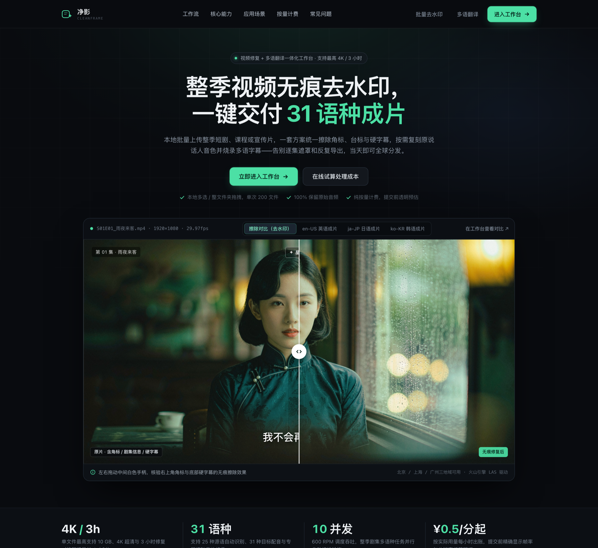
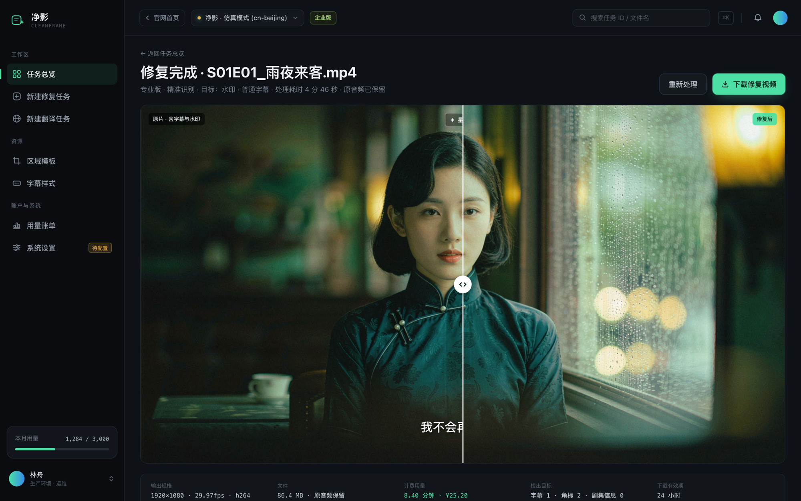
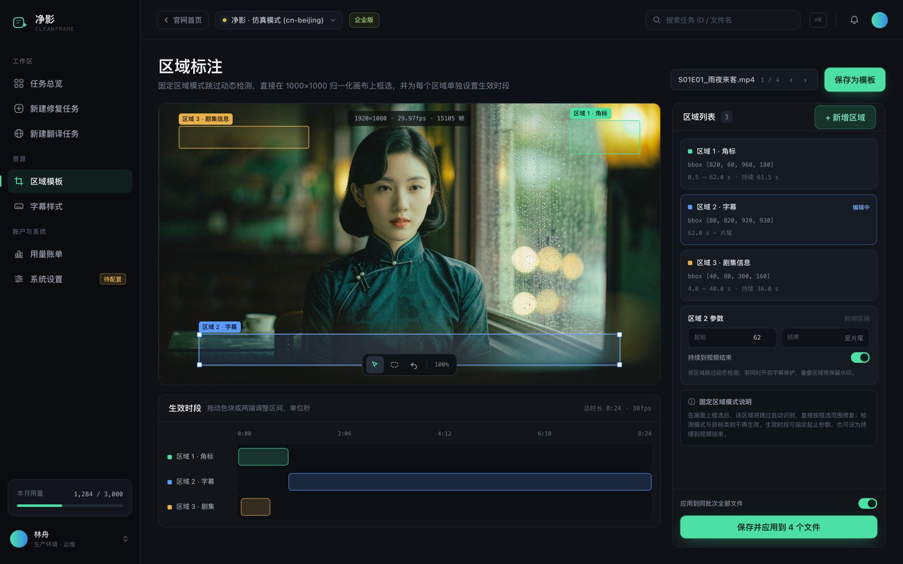
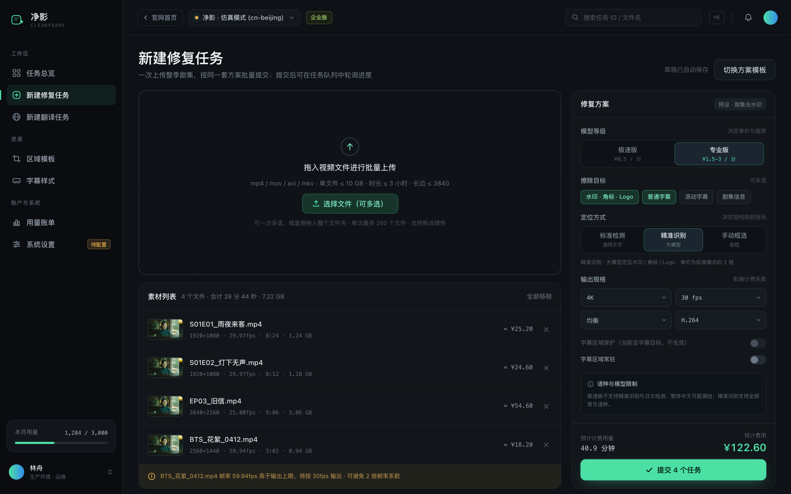
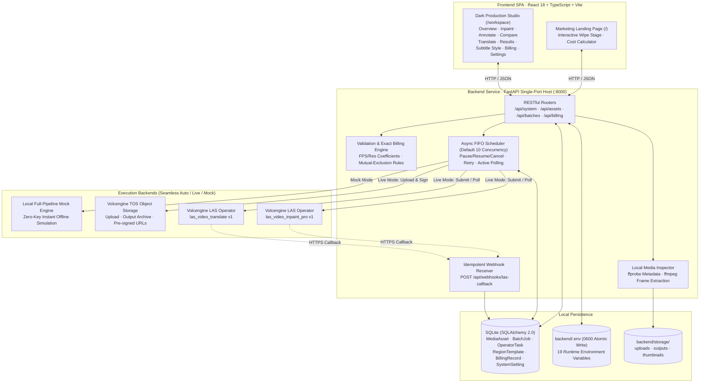

<div align="center">


# CleanFrame (净影)

**Open-Source AI Video Watermark Remover, Hardcoded Subtitle Eraser & 31-Language Video Localization Studio**

[](https://erasevid.com/?utm_source=github&utm_medium=readme_en)
[](https://www.python.org/)
[](https://fastapi.tiangolo.com/)
[](https://react.dev/)
[](https://www.typescriptlang.org/)
[](https://www.volcengine.com/)
[](#5-minute-quick-start)
[](https://github.com/xuliang2024/video-watermark-remover/stargazers)

<p align="center">
  <a href="../../README.md">简体中文</a> ·
  <strong>English</strong> ·
  <a href="./README.ja.md">日本語</a> ·
  <a href="./README.ko.md">한국어</a> ·
  <a href="./README.es.md">Español</a> ·
  <a href="./README.ru.md">Русский</a>
</p>

<p align="center">
  <a href="https://erasevid.com/?utm_source=github&utm_medium=readme_en"><strong>🚀 Official Cloud Studio (EraseVid.com · Zero-Setup SaaS)</strong></a> ·
  <a href="#overview">Overview</a> ·
  <a href="#key-features">Key Features</a> ·
  <a href="#live-ui--preview-gallery">Preview Gallery</a> ·
  <a href="#system-architecture">Architecture</a> ·
  <a href="#5-minute-quick-start">Quick Start</a> ·
  <a href="#environment-variables-19-settings">Configuration</a> ·
  <a href="#operators-languages--billing-formulas">Operators & Languages</a> ·
  <a href="#rest-api-reference">REST API</a> ·
  <a href="#faq">FAQ</a>
</p>

> **Want instant results without self-hosting or managing cloud API keys?** Launch the official hosted cloud workspace at **[https://erasevid.com](https://erasevid.com/?utm_source=github&utm_medium=readme_en)** — zero infrastructure setup, multi-member team workspaces, pay-as-you-go billing with automatic failure refunds, and free trial credits upon sign-up.



</div>

---

## Overview

**CleanFrame (净影)** is a production-grade, open-source batch video post-production and localization studio built for **short-drama distributors, cross-border e-commerce sellers, MCN agencies, online educators, and independent creators**. Powered by **FastAPI + React 18 + TypeScript** and deeply integrated with Volcengine LAS AI video operators (`las_video_inpaint_pro v1` for video watermark/subtitle inpainting and `las_video_translate v1` for 31-language voice-cloned dubbing & subtitle burn-in), CleanFrame unifies **batch video upload, normalized bounding-box annotation, seamless watermark/hard-subtitle removal, and multi-language video localization** into a single dark-mode studio workspace.

> **Zero-Key Instant Preview (`Local Mock Mode`)**: No cloud API keys are required to try CleanFrame. Clone the repository and run `./start.sh` to launch the full-featured **Local Mock Simulator** out of the box—complete with interactive bounding-box annotation, before/after wipe slider, multi-language subtitle alignment, batch queue controls, and live cost estimation. Whenever you are ready for production, enter your Volcengine LAS & TOS credentials in `/workspace#settings` to hot-switch into `Live` mode without restarting or editing code.

### Why CleanFrame?

| Legacy Video Cleaning & Localization Workflow | CleanFrame Unified Studio Pipeline |
| :--- | :--- |
| Manually blurring or cropping logos episode-by-episode in NLE editors, ruining framing | **Spatiotemporal AI Video Inpainting** seamlessly reconstructs backgrounds behind dynamic logos, corner bugs, tickers, and burned-in subtitles while keeping 100% original audio |
| Re-drawing the same corner watermark mask across 80–120 short-drama episodes | **1000×1000 Normalized Region Templates** with per-box start/end timeline intervals, saved once and applied across an entire season |
| Juggling 4–5 disconnected tools for subtitle erasure, translation, TTS dubbing, and hardsubbing | **Chained "Inpaint First -> Translate & Burn" Pipeline**: cleans the master video once and fans out to up to 31 target languages in parallel |
| Uploading 50/60fps footage blindly to cloud APIs and paying 2× unexpected overages | **Pre-flight Per-File Billing Engine & High-FPS Cost Guard**: warns on >30fps uploads and caps output at 30fps to cut processing cost by 50% |
| Writing custom TOS uploaders, polling loops, and retry scripts from scratch | **Built-in 10-Concurrency Async FIFO Scheduler + Idempotent Webhook + Visual Settings UI** served from a single port |

---

## Key Features

### 1. Seamless AI Video Watermark & Hardcoded Subtitle Removal (`las_video_inpaint_pro v1`)
- **Orthogonal Target Selection**: Freely combine `Watermarks / Logos / Corner Bugs`, `Standard Subtitles`, `Scrolling Tickers`, and `Episode Title Cards`.
- **Three Precision Modes**:
  - **Pro · VLM Precise Detection (`precise`)**: Vision-Language Model enhanced localization for semi-transparent station logos, floating watermarks, stylized typography, and complex backgrounds.
  - **Pro / Lite · Standard Detection (`standard_*`)**: High-throughput removal for standard hardcoded subtitles and text overlays, starting at `¥0.50 / min` in Lite mode.
  - **Manual Fixed Bounding Boxes (`fixed_bboxes`)**: Bypass full-frame detection by drawing multiple color-coded boxes on a `1000×1000` normalized canvas with independent start/end timestamps (e.g., `0.5s–62.0s` for opening credits, `62.0s–End` for subtitles) for zero false positives.
- **Smart Subtitle Protection (`subtitle_protect`)**: Erase corner watermarks while strictly preserving original dialogue subtitles.
- **Up to 4K & 3 Hours per Video**: Supports H.264 / H.265 codecs, 720p / 1080p / 4K output caps, and quality/bitrate presets.

### 2. 31-Language Video Translation, 1:1 Voice Cloning & Subtitle Burn-in (`las_video_translate v1`)
- **25 Source Languages -> 31 Target Languages**: Simultaneous batch delivery across English, Japanese, Korean, Spanish, Indonesian, Portuguese, French, German, Thai, Vietnamese, Arabic, Russian, and more.
- **1:1 Speaker Timbre & Emotion Cloning**: Choose between Standard Voice Cloning (`¥1.50 / min`) and High-Quality Dubbing (`¥4.00 / min` with `enable_fast_mode`), plus `enable_dynamic_duration` for automatic lip/phrase pacing alignment.
- **Chained Pre-Inpainting**: Enable `Erase Watermark/Subtitles Before Translation` so CleanFrame generates one clean master video and shares it across all target language tracks.
- **Visual Subtitle Burn-in Studio**: Automatically maps language-appropriate `NotoSans` font families (`NotoSansJP`, `NotoSansKR`, `NotoSansArabic`, `NotoSansThai`, etc.) with real-time 16:9 preview for font size, stroke width, background opacity, and safe margins, plus one-click `.srt` + `.ass` ZIP export.

### 3. Studio-Grade Batch Operations & Cost Governance
- **Native Media Inspection**: Automatically invokes local `ffprobe` / `ffmpeg` on upload to extract resolution, FPS, codec, duration, and first-frame thumbnails.
- **10-Concurrency Async Queue & Dual Convergence**: Matches Volcengine's default `10 concurrent tasks / 600 RPM` account quota with both active polling and idempotent HTTPS webhook callbacks (`/api/webhooks/las-callback`). Pause, resume, cancel batches, or retry individual failed tasks in one click.
- **Visual 19-Variable Settings & Dual Persistence**: Test LAS & TOS connectivity from unsaved form drafts, mask stored secrets automatically, and persist atomically to both SQLite (`system_settings`) and `backend/.env` (`0600` permissions).
- **Command Palette (`⌘K` / `Ctrl+K`)**: Jump between any of the 10 workspace views, apply presets, or search tasks instantaneously from the keyboard.

---

## Live UI & Preview Gallery

### 1. Pixel-Accurate Before / After Watermark & Subtitle Erasure Slider
Drag the interactive split handle right inside the browser to inspect corner-bug, episode-badge, and bottom hard-subtitle reconstruction frame by frame:

<p align="center">
  
</p>

### 2. 1000×1000 Normalized Canvas Bounding-Box & Multi-Track Timeline Annotation
Draw custom regions directly on the 16:9 frame, assign exact active time ranges on the multi-track timeline, and save reusable templates for 100-episode series:

<p align="center">
  
</p>

### 3. Multi-Language Dubbed Video Delivery & Time-Coded Subtitle Alignment
Preview English (`en-US`), Japanese (`ja-JP`), and Korean (`ko-KR`) burned-in outputs side by side, click any caption row to scrub the preview, and download videos + `.srt`/`.ass` bundles:

<p align="center">
  
</p>

### 4. Production Studio Views (2×2 Gallery)

<table>
  <tr>
    <td width="50%" valign="top">
      
      <p align="center"><strong>Batch Overview & Queue Telemetry</strong><br/><sub>Real-time concurrency gauge, monthly quota tracker, 5-state filter & task drill-down</sub></p>
    </td>
    <td width="50%" valign="top">
      
      <p align="center"><strong>Batch Watermark Removal Builder</strong><br/><sub>Multi-file drag & drop, preset switching, high-FPS cost saver alert & per-file estimate</sub></p>
    </td>
  </tr>
  <tr>
    <td width="50%" valign="top">
      
      <p align="center"><strong>Live Subtitle Burn-in Designer</strong><br/><sub>Real-time 16:9 composition preview, cinema presets, stroke, shadow & safe-margin controls</sub></p>
    </td>
    <td width="50%" valign="top">
      
      <p align="center"><strong>Transparent Unit Pricing & Interactive Estimator</strong><br/><sub>Estimate full-season inpainting + multi-language dubbing budgets before submission</sub></p>
    </td>
  </tr>
</table>

### 5. Zero-Friction Onboarding & Single-Tenant Environment Center

<table>
  <tr>
    <td width="50%" valign="top">
      
      <p align="center"><strong>First-Run Onboarding Wizard</strong><br/><sub>Explore immediately in Local Mock mode or jump straight to credential setup</sub></p>
    </td>
    <td width="50%" valign="top">
      
      <p align="center"><strong>19-Setting Control Center & Live Probe</strong><br/><sub>Masked secrets, pre-save LAS/TOS connectivity verification & dual SQLite/.env persistence</sub></p>
    </td>
  </tr>
</table>

---

## System Architecture



---

## 5-Minute Quick Start

### Prerequisites

- **Python**: `3.10+` (`3.11+` recommended)
- **Node.js**: `18.0+` (with `npm`)
- **FFmpeg / FFprobe** *(optional, recommended for real video metadata & thumbnail extraction)*:
  - macOS: `brew install ffmpeg`
  - Ubuntu / Debian: `sudo apt update && sudo apt install -y ffmpeg`
  - Windows: `winget install Gyan.FFmpeg`

### Option 1: One-Click Production Launch (Recommended)

Runs both the compiled React SPA and FastAPI backend on port `8000` (defaults to `auto` mode, activating the local Mock simulator until cloud keys are configured):

```bash
# 1. Clone repository
git clone https://github.com/xuliang2024/video-watermark-remover.git
cd video-watermark-remover

# 2. Install Python backend dependencies
python3 -m venv .venv
source .venv/bin/activate
pip install -r backend/requirements.txt

# 3. Install frontend dependencies
npm --prefix frontend install

# 4. Build frontend & start single-port server (http://127.0.0.1:8000)
./start.sh
```

Open in your browser:
- **Landing Page**: `http://127.0.0.1:8000/`
- **Production Studio**: `http://127.0.0.1:8000/workspace`
- **System Settings**: `http://127.0.0.1:8000/workspace#settings`
- **Swagger OpenAPI Docs**: `http://127.0.0.1:8000/docs`

### Option 2: Split Frontend / Backend Hot-Reload Development

```bash
# Terminal 1: FastAPI backend with auto-reload (:8000)
source .venv/bin/activate
uvicorn app.main:app --app-dir backend --host 127.0.0.1 --port 8000 --reload

# Terminal 2: Vite dev server (:5173, proxies /api and /media to :8000)
npm --prefix frontend run dev
```

### Option 3: Connect Live Volcengine LAS + TOS Operators

1. **Via Web UI (Recommended, zero-downtime hot reload)**:
   - Navigate to `http://127.0.0.1:8000/workspace#settings`
   - Fill in `LAS_API_KEY`, `TOS_BUCKET`, `VOLC_ACCESS_KEY_ID`, and `VOLC_ACCESS_KEY_SECRET` (ensure TOS bucket and LAS share the same region, e.g. `cn-beijing`)
   - Click **Test Connectivity** to verify API authentication and bucket R/W permissions, then click **Save Settings**.
2. **Via `.env` File**:
   ```bash
   cp backend/.env.example backend/.env
   # Populate LAS_API_KEY and TOS_* credentials in backend/.env
   ```

---

## Environment Variables (19 Settings)

| Group | Variable | Default | Hot-Reload | Description |
| :--- | :--- | :--- | :---: | :--- |
| **1. Runtime & Base** | `CLEANFRAME_EXECUTION_MODE` | `auto` | Yes | `auto` (`live` when keys exist, else `mock`), `live`, or `mock` |
| | `CLEANFRAME_PUBLIC_BASE_URL` | `http://127.0.0.1:8000` | Yes | External base URL for media links and webhook hints |
| | `CLEANFRAME_MONTHLY_QUOTA_MIN` | `3000.0` | Yes | Monthly reference quota (billed minutes) in sidebar & billing |
| **2. Volcengine LAS** | `LAS_API_KEY` | *(empty)* | Yes | Volcengine LAS API Key (masked in UI responses) |
| | `LAS_REGION` | `cn-beijing` | Yes | Operator region: `cn-beijing` / `cn-shanghai` / `cn-guangzhou` |
| | `LAS_BASE_URL` | *(auto)* | Yes | Defaults to `https://operator.las.{LAS_REGION}.volces.com/api/v1` |
| | `LAS_CALLBACK_URL` | *(empty)* | Yes | Optional public HTTPS webhook (`https://.../api/webhooks/las-callback`) |
| **3. Volcengine TOS** | `TOS_BUCKET` | *(empty)* | Yes | TOS bucket name under the same account & region as LAS |
| | `TOS_REGION` | `cn-beijing` | Yes | TOS bucket region |
| | `TOS_ENDPOINT` | `tos-cn-beijing.volces.com` | Yes | TOS service endpoint |
| | `TOS_INPUT_PREFIX` | `cleanframe/inputs` | Yes | Object key prefix for uploaded source videos |
| | `TOS_OUTPUT_PREFIX` | `cleanframe/outputs` | Yes | Object key prefix for processed operator outputs |
| | `VOLC_ACCESS_KEY_ID` | *(empty)* | Yes | Volcengine Access Key ID with TOS R/W permissions |
| | `VOLC_ACCESS_KEY_SECRET` | *(empty)* | Yes | Volcengine Secret Access Key (`0600` file permissions) |
| **4. Scheduler** | `CLEANFRAME_SCHEDULER_ENABLED` | `true` | Yes | Enable background async task dispatcher & poller |
| | `CLEANFRAME_MAX_CONCURRENCY` | `10` | Yes | Maximum parallel operator tasks |
| | `CLEANFRAME_POLL_INTERVAL` | `3.0` | Yes | Active status polling interval in seconds |
| **5. DB & Storage** | `CLEANFRAME_DATABASE_URL` | `sqlite:///./storage/cleanframe.db` | Restart | SQLAlchemy database connection URL |
| | `CLEANFRAME_STORAGE_DIR` | `./storage` | Restart | Local root directory for uploads, outputs, and thumbnails |

---

## Operators, Languages & Billing Formulas

### 1. Video Inpainting (`las_video_inpaint_pro v1`)

**Formula**: `Cost = Unit_Price × (Output_Duration_Min × FPS_Coeff × Resolution_Coeff)`

- **Tiers**:
  - **Lite (`lite`)**: `¥0.50 / min` — fast standard subtitle/watermark removal (1080p `1.0x`, 4K `2.0x`).
  - **Pro · Standard (`pro` + `standard_*` / `fixed_bboxes`)**: `¥1.50 / min` — seamless high-quality text erasure or manual bounding-box inpainting (720p `0.6x`, 1080p `1.0x`, 4K `2.0x`).
  - **Pro · Precise (`pro` + `precise`)**: `¥3.00 / min` — VLM-powered detection for translucent TV logos, floating corner bugs, and decorative titles.
- **FPS Coefficient**: `≤24fps` -> `0.8x`; `24–30fps` -> `1.0x`; `>30fps` -> `⌈fps / 30⌉` (capping 60fps videos at 30fps halves total cost).
- **Media Limits**: Duration `1s – 3h`, file size `≤ 10 GB`, normalized bbox coordinates `[x1, y1, x2, y2] ∈ [0, 1000]`.

### 2. Multi-Language Video Translation (`las_video_translate v1`)

**Formula**: `Cost = Unit_Price × Input_Duration_Min × Target_Language_Count`
- **Standard Voice Cloning (`standard`)**: `¥1.50 / min / language`
- **High-Quality Dubbing (`high_quality`)**: `¥4.00 / min / language` (supports `enable_fast_mode`)
- **25 Source Languages**: `zh-CN`, `yue-CN`, `en-US`, `ja-JP`, `ko-KR`, `es-MX`, `fr-FR`, `de-DE`, `id-ID`, `th-TH`, `vi-VN`, `pt-BR`, `ru-RU`, `ar-SA`, `it-IT`, `tr-TR`, `ms-MY`, `fil-PH`, `hi-IN`, `nl-NL`, `pl-PL`, `sv-SE`, `no-NO`, `da-DK`, `fi-FI`.
- **31 Target Output Languages**: All 25 languages above plus `el-GR` (Greek), `he-IL` (Hebrew), `km-KH` (Khmer), `lo-LA` (Lao), `my-MM` (Burmese), and `sw-KE` (Swahili), each automatically paired with its dedicated `NotoSans` script font.

---

## REST API Reference

Interactive OpenAPI documentation is served at `http://127.0.0.1:8000/docs`:

| Domain | Endpoint | Summary |
| :--- | :--- | :--- |
| **System** | `GET /api/health` | Service health, effective mode (`mock`/`live`), and active region |
| | `GET / PUT /api/system/config` | Read (masked) or hot-update all 19 runtime settings |
| | `POST /api/system/test-connection` | Probe Volcengine LAS & TOS connectivity using saved or draft credentials |
| | `POST /api/webhooks/las-callback` | Idempotent webhook endpoint for async LAS task completion |
| **Assets** | `GET /api/assets` · `POST /api/assets/upload` | List staged media or upload local videos (`ffprobe` + `ffmpeg` thumbnail) |
| **Batches** | `POST /api/estimates/{inpaint\|translate}` | Exact pre-submission cost, billed-minute, and high-FPS warnings |
| | `POST /api/batches/{inpaint\|translate}` | Submit batch jobs to the 10-concurrency async scheduler |
| | `POST /api/batches/{id}/{pause\|resume\|cancel}` | Lifecycle controls for running or queued batches |
| | `POST /api/tasks/{id}/retry` | One-click retry for failed or timed-out operator tasks |
| | `GET /api/tasks/{id}/download-captions` | Download multi-language `.srt` + `.ass` captions as a `.zip` archive |
| **Resources** | `GET / POST / DELETE /api/templates/regions` | Manage reusable `1000×1000` normalized bounding-box templates |
| | `GET / PUT /api/settings/subtitle-style` | Read or persist global burned-in subtitle styling |
| | `GET /api/billing/summary` · `GET /api/billing/export` | Usage ledger summary and CSV financial export |

---

## Testing & Verification

```bash
# 1. Backend unit & end-to-end integration suite (isolated temp SQLite & temp .env)
pytest backend/tests/test_cleanframe.py -q

# 2. Frontend TypeScript type-check & production Vite bundle
npm --prefix frontend run build
```

---

## FAQ

**Q1: Can I evaluate the entire product without a Volcengine account?**
Yes. In the default `CLEANFRAME_EXECUTION_MODE=auto`, CleanFrame automatically runs its built-in `Mock` simulation engine when no API key is configured, letting you test uploads, region drawing, batch queuing, before/after comparison, and caption ZIP downloads completely offline.

**Q2: How do I remove a fixed corner watermark across 100 episodes without touching original subtitles?**
Either pick the **"Logo Only · Protect Subtitles"** preset (`subtitle_protect=true`), or draw a fixed bounding box over the corner bug in `/workspace#annotate`, save it as a template, and apply it to the entire batch—fixed-box mode skips full-frame detection so nothing outside your box is altered.

**Q3: Why does CleanFrame recommend capping 60fps videos at 30fps?**
`las_video_inpaint_pro` bills `≤30fps` at a `1.0x` multiplier and `60fps` at `2.0x`. Capping output at `30fps` preserves smooth playback for short dramas and courses while immediately saving **50%** on compute costs.

---

<div align="center">

If **CleanFrame** helps streamline your video cleaning or global localization workflow, please consider giving the repository a **Star**!

**[Back to Top](#cleanframe-净影)**

</div>
