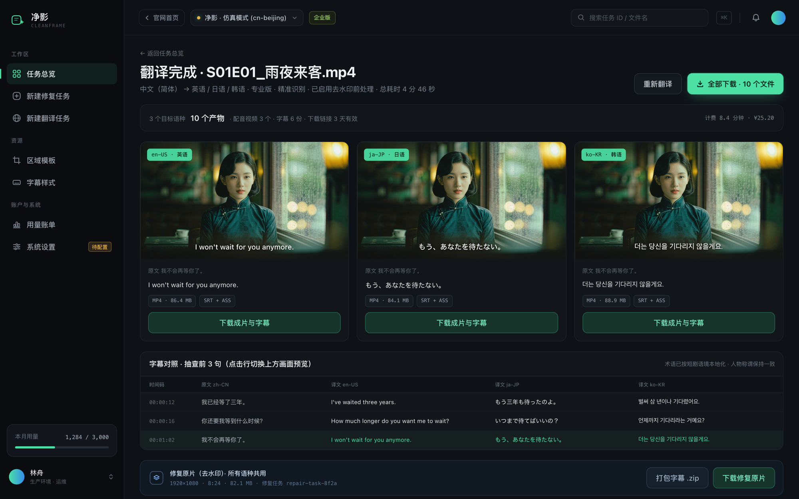
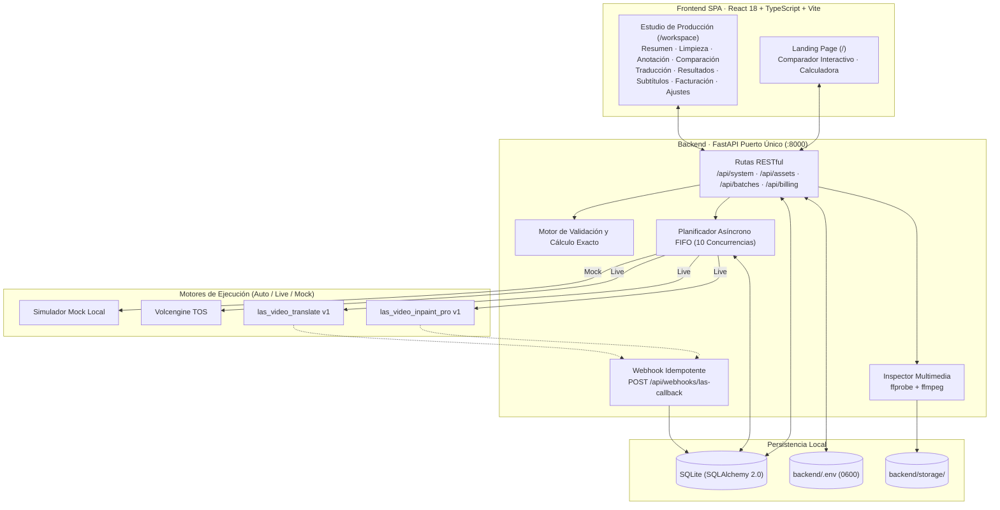

<div align="center">


# CleanFrame (净影)

**Estudio Open-Source con IA para Eliminar Marcas de Agua en Video, Borrar Subtítulos Incrustados y Traducir/Doblar a 31 Idiomas**

[](https://erasevid.com/?utm_source=github&utm_medium=readme_es)
[](https://www.python.org/)
[](https://fastapi.tiangolo.com/)
[](https://react.dev/)
[](https://www.typescriptlang.org/)
[](https://www.volcengine.com/)
[](#inicio-rápido-en-5-minutos)
[](https://github.com/xuliang2024/video-watermark-remover/stargazers)

<p align="center">
  <a href="../../README.md">简体中文</a> ·
  <a href="./README.en.md">English</a> ·
  <a href="./README.ja.md">日本語</a> ·
  <a href="./README.ko.md">한국어</a> ·
  <strong>Español</strong> ·
  <a href="./README.ru.md">Русский</a>
</p>

<p align="center">
  <a href="#descripción-general">Descripción</a> ·
  <a href="#características-principales">Características</a> ·
  <a href="#galería-de-interfaz-y-resultados">Galería</a> ·
  <a href="#arquitectura-del-sistema">Arquitectura</a> ·
  <a href="#inicio-rápido-en-5-minutos">Inicio Rápido</a> ·
  <a href="#variables-de-entorno-19-ajustes">Configuración</a> ·
  <a href="#operadores-idiomas-y-fórmulas-de-costos">Idiomas y Costos</a> ·
  <a href="#referencia-de-api-rest">API REST</a> ·
  <a href="#preguntas-frecuentes-faq">FAQ</a>
</p>

> **Dos formas de usarlo, el mismo código**
>
> - **Autoalojado**: clona el repositorio y ejecuta `docker compose up -d` (o `./start.sh`). Apache-2.0, el material no sale de tu servidor. Necesitas tus propias credenciales de Volcengine LAS / TOS.
> - **En la nube**: [erasevid.com](https://erasevid.com/?utm_source=github&utm_medium=readme_es) —— sin servidor, facturación por uso a cargo de la plataforma. Las tareas fallidas se reembolsan automáticamente.


<p align="center">
  🚀 <strong>¿Sin despliegue?</strong> <a href="https://erasevid.com/?lang=es&utm_source=github&utm_medium=readme_es&utm_content=hero"><strong>Probar EraseVid online</strong></a> · <a href="https://erasevid.com/cases?lang=es&utm_source=github&utm_medium=readme_es&utm_content=hero">11 casos reales</a> · <a href="https://erasevid.com/workspace?lang=es&utm_source=github&utm_medium=readme_es&utm_content=hero">Estudio online</a>
</p>

</div>

---

## Descripción General

**CleanFrame (净影)** es un estudio de posproducción y localización de video por lotes de código abierto diseñado para **distribuidores de micro-dramas (short dramas), vendedores de e-commerce transfronterizo, agencias MCN, plataformas educativas y creadores de contenido**. Construido con **FastAPI + React 18 + TypeScript** e integrado con operadores de IA de video (`las_video_inpaint_pro v1` para inpainting de marcas de agua/subtítulos y `las_video_translate v1` para doblaje con clonación de voz y quemado de subtítulos en 31 idiomas), reúne **carga masiva, anotación de cajas delimitadoras normalizadas 1000×1000, eliminación sin rastro de marcas de agua en video (TikTok, YouTube, Reels, Sora, Runway, logos de TV) y subtítulos incrustados (hardsubs), y traducción/doblaje multilingüe** en una sola estación de trabajo oscura de nivel cinematográfico.

> **Prueba Instantánea sin Claves API (`Modo Mock Local`)**: No necesitas credenciales en la nube para probar CleanFrame. Clona el repositorio y ejecuta `./start.sh` para iniciar el **Simulador Local Completo**, con anotación interactiva de áreas, comparador deslizante antes/después, tabla bilingüe de subtítulos y calculadora de costos. Cuando desees pasar a producción, ingresa tus claves de Volcengine LAS / TOS en `/workspace#settings` para cambiar en caliente al modo `Live`.

### ¿Qué problemas resuelve?

| Flujo tradicional de limpieza y localización | Pipeline unificado de CleanFrame |
| :--- | :--- |
| Desenfocar o recortar logotipos episodio por episodio en editores tradicionales, arruinando el encuadre | **Inpainting espaciotemporal con IA** que reconstruye el fondo detrás de logos dinámicos, moscas de TV y subtítulos incrustados conservando el 100% del audio original |
| Dibujar manualmente la misma máscara en 80–120 episodios de una serie corta | **Plantillas normalizadas 1000×1000** con intervalos de inicio/fin independientes en línea de tiempo, aplicables a toda la temporada con un clic |
| Alternar entre 4–5 herramientas distintas para borrar texto, traducir, doblar y quemar subtítulos | **Cadena directa «Limpiar marca/subtítulo -> Doblar y quemar en 31 idiomas»** compartiendo un único máster limpio |
| Subir videos a 50/60fps sin control y pagar el doble en facturación por minuto | **Cálculo exacto previo por archivo + Alerta automática de alto FPS** (limitar a 30fps ahorra inmediatamente un 50%) |

---

## Características Principales

### 1. Eliminación de Marcas de Agua y Subtítulos Incrustados con IA (`las_video_inpaint_pro v1`)
- **Selección ortogonal de objetivos**: `Marcas de agua / Logos`, `Subtítulos estándar`, `Texto desplazable (tickers)` e `Información de episodio`.
- **Tres estrategias de localización**:
  - **Pro · Detección Precisa VLM (`precise`)**: Ideal para logos semitransparentes, marcas flotantes y tipografías decorativas complejas.
  - **Pro / Lite · Detección Estándar (`standard_*`)**: Limpieza masiva de subtítulos con alta relación costo-beneficio (desde `¥0.50 / min` en modo Lite).
  - **Cajas Fijas Manuales (`fixed_bboxes`)**: Dibuja múltiples rectángulos sobre un lienzo normalizado `1000×1000` con tiempos exactos de activación para eliminar falsos positivos.
- **Protección inteligente de subtítulos (`subtitle_protect`)**: Borra únicamente el logotipo de la esquina protegiendo los subtítulos originales.
- **Soporte hasta 4K y 3 horas por archivo**: Salida en H.264 / H.265 y límites de 720p / 1080p / 4K.

### 2. Traducción de Video a 31 Idiomas, Clonación de Voz 1:1 y Subtítulos (`las_video_translate v1`)
- **25 idiomas de origen -> 31 idiomas de destino**: Español (`es-MX`), Inglés (`en-US`), Japonés, Coreano, Portugués (`pt-BR`), Francés, Alemán, Italiano, Indonesio, Tailandés, Vietnamita, Árabe, Ruso y más.
- **Clonación emocional de voz 1:1**: Modo estándar (`¥1.50 / min`) y doblaje de alta calidad (`¥4.00 / min` con `enable_fast_mode`), además de ajuste dinámico de duración (`enable_dynamic_duration`).
- **Estudio visual de subtítulos quemados**: Selección automática de fuentes `NotoSans` por alfabeto, vista previa 16:9 en vivo de tamaño, contorno, opacidad de fondo y márgenes, más descarga masiva `.srt` + `.ass` en `.zip`.

### 3. Cola Asíncrona de 10 Tareas Concurrentes y Centro de Configuración Web
- **Inspección multimedia local**: Extracción automática de metadatos y miniaturas con `ffprobe` y `ffmpeg`.
- **Cola FIFO de 10 concurrencias + Webhook idempotente**: Sondeo activo y recepción en `/api/webhooks/las-callback`, con pausa, reanudación, cancelación y reintento por tarea.
- **Panel visual de 19 variables + Paleta de comandos (`⌘K` / `Ctrl+K`)**: Prueba de conectividad LAS/TOS antes de guardar y persistencia dual en SQLite y `backend/.env` (`0600`).

---

## Galería de Interfaz y Resultados

### 1. Comparador Deslizante Antes / Después a Nivel de Píxel
<p align="center">
  
</p>

### 2. Anotación de Regiones 1000×1000 y Línea de Tiempo Multipista
<p align="center">
  
</p>

### 3. Entrega Multilingüe en 31 Idiomas y Tabla Comparativa de Subtítulos
<p align="center">
  
</p>

### 4. Vistas del Estudio de Producción (Cuadrícula 2×2)

<table>
  <tr>
    <td width="50%" valign="top">
      
      <p align="center"><strong>Resumen de Lotes y Telemetría de Cola</strong><br/><sub>Concurrencia en vivo, cuota mensual y filtros por estado</sub></p>
    </td>
    <td width="50%" valign="top">
      
      <p align="center"><strong>Creador de Lotes Antimarca de Agua</strong><br/><sub>Carga por arrastre, alerta de ahorro en 60fps y presupuesto previo exacto</sub></p>
    </td>
  </tr>
  <tr>
    <td width="50%" valign="top">
      
      <p align="center"><strong>Diseñador en Vivo de Subtítulos Quemados</strong><br/><sub>Previsualización 16:9 instantánea, bordes, sombras y márgenes seguros</sub></p>
    </td>
    <td width="50%" valign="top">
      
      <p align="center"><strong>Tarifas Transparentes y Calculadora Interactiva</strong><br/><sub>Calcula el costo total de limpieza y doblaje de temporadas completas</sub></p>
    </td>
  </tr>
</table>

### 5. Asistente Inicial y Configuración del Sistema

<table>
  <tr>
    <td width="50%" valign="top">
      
      <p align="center"><strong>Asistente de Primer Inicio</strong><br/><sub>Explora al instante en modo Mock local o configura tus credenciales</sub></p>
    </td>
    <td width="50%" valign="top">
      
      <p align="center"><strong>Centro de 19 Variables y Prueba de Conexión</strong><br/><sub>Secretos enmascarados, diagnóstico LAS/TOS y persistencia dual SQLite/.env</sub></p>
    </td>
  </tr>
</table>

---

## Arquitectura del Sistema



---

## Versión online: sin despliegue, lista al registrarte

Si solo quieres **procesar un vídeo ahora mismo** sin instalar Docker ni solicitar credenciales de Volcengine LAS / TOS, usa **[EraseVid online](https://erasevid.com/?lang=es&utm_source=github&utm_medium=readme_es&utm_content=section)**: comparte código y operadores con esta edición open source; regístrate y procesa vídeos desde el navegador.

| | Autoalojado (este repositorio) | [EraseVid online](https://erasevid.com/?lang=es&utm_source=github&utm_medium=readme_es&utm_content=section) |
| :--- | :--- | :--- |
| Puesta en marcha | `docker compose up -d` o `./start.sh` | Nada que instalar, funciona en el navegador |
| Credenciales | Tus propias claves LAS / TOS | Las aporta la plataforma, sin trámites |
| Facturación | Según tu proveedor cloud | Pago por uso; tareas fallidas reembolsadas automáticamente |
| Datos | El material permanece en tu servidor | Se sube a la plataforma para su procesamiento |

- 👉 **[Regístrate gratis y procesa un vídeo](https://erasevid.com/?lang=es&utm_source=github&utm_medium=readme_es&utm_content=section)**
- 🎬 **[Ver 11 casos reales con comparativa antes/después](https://erasevid.com/cases?lang=es&utm_source=github&utm_medium=readme_es&utm_content=section)**
- 🖥️ **[Abrir el estudio online](https://erasevid.com/workspace?lang=es&utm_source=github&utm_medium=readme_es&utm_content=section)** (requiere iniciar sesión)

> ¿Prefieres ver resultados antes que código? Empieza por los [casos reales](https://erasevid.com/cases?lang=es&utm_source=github&utm_medium=readme_es&utm_content=section); a continuación se explica el despliegue autoalojado.

---

## Inicio Rápido en 5 Minutos

> Las cuatro opciones siguientes corresponden al **autoalojado** de la edición open source; elige la que mejor encaje con tu entorno.

### Ejecutar con Docker (recomendado, sin dependencias)

Solo necesitas Docker y Docker Compose. No hace falta instalar Python, Node.js ni FFmpeg: la imagen ya los incluye.

```bash
git clone https://github.com/xuliang2024/video-watermark-remover.git
cd video-watermark-remover
docker compose up -d
```

Los datos se guardan en `./data` del host. Consulta [README.en.md](./README.en.md#option-1-docker-compose-recommended-zero-dependencies) para más detalles.

```bash
# 1. Clonar el repositorio
git clone https://github.com/xuliang2024/video-watermark-remover.git
cd video-watermark-remover

# 2. Instalar dependencias del backend (Python 3.10+)
python3 -m venv .venv
source .venv/bin/activate
pip install -r backend/requirements.txt

# 3. Instalar dependencias del frontend (Node.js 18+)
npm --prefix frontend install

# 4. Compilar frontend e iniciar servidor en puerto único (http://127.0.0.1:8000)
./start.sh
```

Accesos locales:
- **Página Principal**: `http://127.0.0.1:8000/`
- **Estudio de Trabajo**: `http://127.0.0.1:8000/workspace`
- **Ajustes de Entorno**: `http://127.0.0.1:8000/workspace#settings`
- **Documentación Swagger**: `http://127.0.0.1:8000/docs`

---

## Variables de Entorno (19 Ajustes)

| Grupo | Variable | Valor por Defecto | Recarga en Caliente | Descripción |
| :--- | :--- | :--- | :---: | :--- |
| **1. Ejecución** | `CLEANFRAME_EXECUTION_MODE` | `auto` | Sí | `auto` (`live` si hay claves, si no `mock`), `live` o `mock` |
| | `CLEANFRAME_PUBLIC_BASE_URL` | `http://127.0.0.1:8000` | Sí | URL pública base del servicio |
| | `CLEANFRAME_MONTHLY_QUOTA_MIN` | `3000.0` | Sí | Cuota mensual de referencia en minutos |
| **2. Volcengine LAS** | `LAS_API_KEY` | *(vacío)* | Sí | Clave API de Volcengine LAS |
| | `LAS_REGION` | `cn-beijing` | Sí | `cn-beijing` / `cn-shanghai` / `cn-guangzhou` |
| | `LAS_BASE_URL` | *(automático)* | Sí | Endpoint API derivado automáticamente por región |
| | `LAS_CALLBACK_URL` | *(vacío)* | Sí | URL HTTPS pública opcional para webhook |
| **3. Volcengine TOS** | `TOS_BUCKET` | *(vacío)* | Sí | Nombre del bucket TOS en la misma región que LAS |
| | `TOS_REGION` | `cn-beijing` | Sí | Región del bucket TOS |
| | `TOS_ENDPOINT` | `tos-cn-beijing.volces.com` | Sí | Endpoint de Volcengine TOS |
| | `TOS_INPUT_PREFIX` | `cleanframe/inputs` | Sí | Prefijo de objetos de entrada |
| | `TOS_OUTPUT_PREFIX` | `cleanframe/outputs` | Sí | Prefijo de objetos de salida |
| | `VOLC_ACCESS_KEY_ID` | *(vacío)* | Sí | Access Key ID con permisos sobre el bucket |
| | `VOLC_ACCESS_KEY_SECRET` | *(vacío)* | Sí | Secret Access Key (`0600`) |
| **4. Planificador** | `CLEANFRAME_SCHEDULER_ENABLED` | `true` | Sí | Activa el planificador asíncrono en segundo plano |
| | `CLEANFRAME_MAX_CONCURRENCY` | `10` | Sí | Máximo de tareas paralelas |
| | `CLEANFRAME_POLL_INTERVAL` | `3.0` | Sí | Intervalo de sondeo en segundos |
| **5. BD y Archivos** | `CLEANFRAME_DATABASE_URL` | `sqlite:///./storage/cleanframe.db` | Reinicio | Cadena de conexión SQLAlchemy |
| | `CLEANFRAME_STORAGE_DIR` | `./storage` | Reinicio | Directorio local de almacenamiento |

---

## Operadores, Idiomas y Fórmulas de Costos

- **Inpainting de Video (`las_video_inpaint_pro v1`)**: `Costo = Precio_Unitario × (Minutos_Salida × Coef_FPS × Coef_Resolución)`
  - Tarifas: Lite `¥0.50/min`, Pro Estándar `¥1.50/min`, Pro Preciso `¥3.00/min`.
  - Coeficiente FPS: `≤24fps` `0.8x`, `24–30fps` `1.0x`, `>30fps` `⌈fps/30⌉`.
  - Coeficiente Resolución (Pro): `720p` `0.6x`, `1080p` `1.0x`, `4K` `2.0x`.
- **Traducción Multilingüe (`las_video_translate v1`)**: `Costo = Precio_Unitario × Minutos_Entrada × Número_Idiomas_Destino`
  - Tarifas: Clonación estándar `¥1.50/min/idioma`, Alta calidad `¥4.00/min/idioma`.
  - **Idiomas soportados**: 25 idiomas de origen -> 31 idiomas de destino (`es-MX`, `en-US`, `pt-BR`, `fr-FR`, `de-DE`, `it-IT`, `ja-JP`, `ko-KR`, `zh-CN`, `id-ID`, `th-TH`, `vi-VN`, `ar-SA`, `ru-RU`, entre otros).

---

## Referencia de API REST

Explora y prueba todos los endpoints en vivo en `http://127.0.0.1:8000/docs`:
- `GET / PUT /api/system/config` · `POST /api/system/test-connection`: Gestión de configuración y prueba de conectividad
- `POST /api/assets/upload`: Subida de videos con inspección automática `ffprobe` / `ffmpeg`
- `POST /api/estimates/{inpaint|translate}`: Presupuesto exacto previo al envío
- `POST /api/batches/{inpaint|translate}`: Creación y encolado de lotes asíncronos
- `GET /api/tasks/{id}/download-captions`: Descarga comprimida `.zip` de subtítulos `.srt` y `.ass`

```bash
# Ejecutar suite de pruebas e inspección de compilación
pytest backend/tests/test_cleanframe.py -q
npm --prefix frontend run build
```

---

## Preguntas Frecuentes (FAQ)

**P1: ¿Puedo probar toda la aplicación sin tener cuenta en Volcengine?**
Sí. Con `CLEANFRAME_EXECUTION_MODE=auto`, CleanFrame activa automáticamente el simulador local `Mock` si no detecta claves API, permitiendo recorrer todo el flujo sin conexión.

**P2: ¿Cómo elimino un logo fijo en toda una serie sin borrar los subtítulos originales?**
Selecciona el preajuste **«Solo Logo · Proteger Subtítulos»** (`subtitle_protect=true`) o dibuja un recuadro fijo sobre el logo en `/workspace#annotate` y guárdalo como plantilla para todo el lote.

**P6: ¿Existe una versión online si no quiero autoalojar el proyecto?**
Sí. [EraseVid online](https://erasevid.com/?lang=es&utm_source=github&utm_medium=readme_es&utm_content=faq) utiliza el mismo código y los mismos operadores, sin despliegue ni credenciales propias: regístrate y empieza a subir vídeos. El pago es por uso y las tareas fallidas se reembolsan automáticamente. Puedes revisar primero los [casos reales](https://erasevid.com/cases?lang=es&utm_source=github&utm_medium=readme_es&utm_content=faq); usa este repositorio si necesitas controlar los datos o ampliar el código.

---

<div align="center">

Si **CleanFrame** impulsa tu flujo de limpieza o localización de video, ¡apóyanos dejando una **Star** en GitHub!

[EraseVid online](https://erasevid.com/?lang=es&utm_source=github&utm_medium=readme_es&utm_content=footer) · [Casos reales](https://erasevid.com/cases?lang=es&utm_source=github&utm_medium=readme_es&utm_content=footer) · [Estudio online](https://erasevid.com/workspace?lang=es&utm_source=github&utm_medium=readme_es&utm_content=footer) · [GitHub Issues](https://github.com/xuliang2024/video-watermark-remover/issues)

**[Volver arriba](#cleanframe-净影)**

</div>
