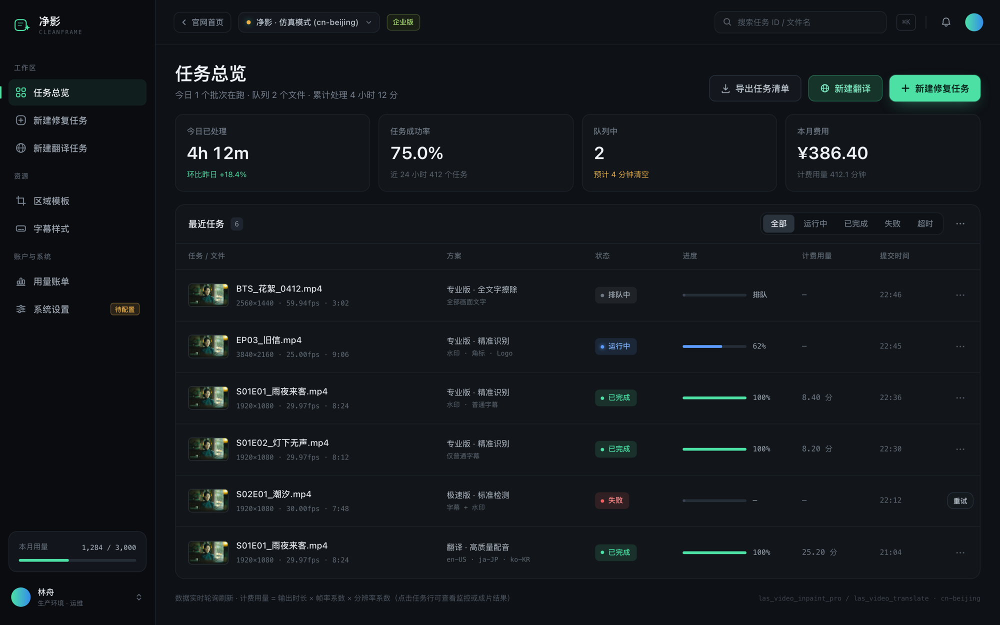
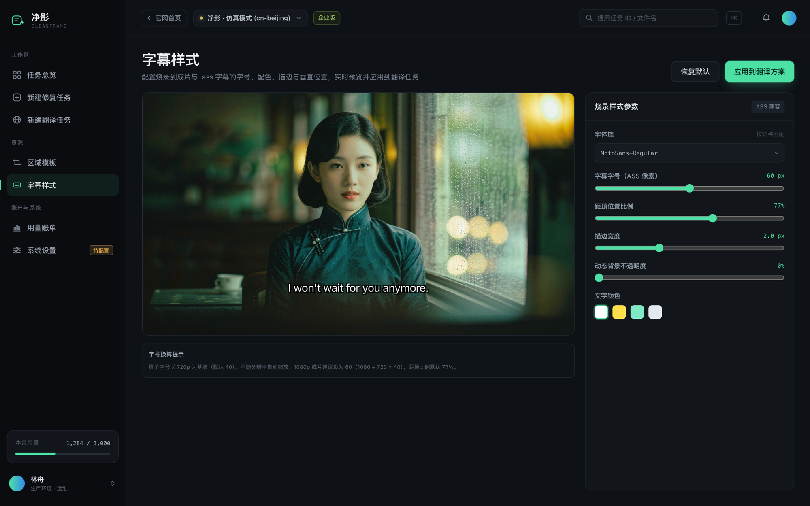
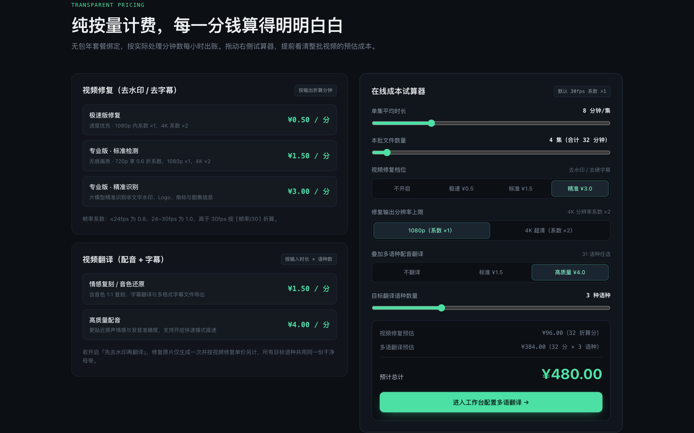
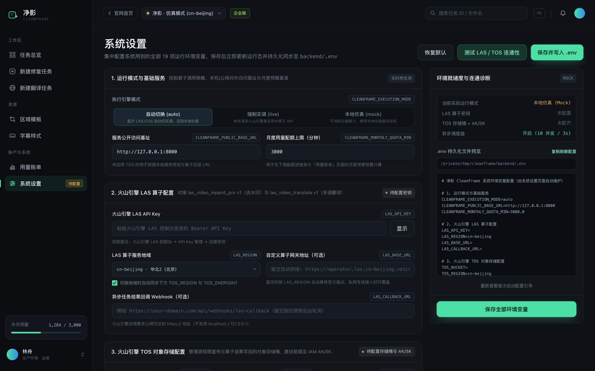
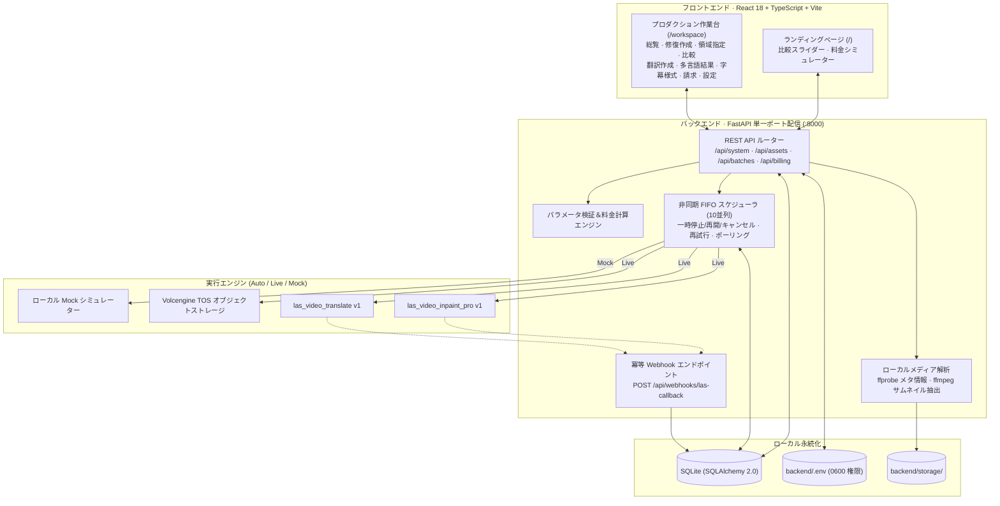

<div align="center">


# 浄影 CleanFrame

**オープンソース AI 動画透かし消去・焼き込み字幕除去・31言語動画翻訳＆吹き替え統合スタジオ**

*Open-Source AI Video Watermark Remover, Hardcoded Subtitle Eraser & 31-Language Video Localization Studio*

[](https://erasevid.com/?utm_source=github&utm_medium=readme_ja)
[](https://www.python.org/)
[](https://fastapi.tiangolo.com/)
[](https://react.dev/)
[](https://www.typescriptlang.org/)
[](https://www.volcengine.com/)
[](#5分クイックスタート)
[](https://github.com/xuliang2024/video-watermark-remover/stargazers)

<p align="center">
  <a href="../../README.md">简体中文</a> ·
  <a href="./README.en.md">English</a> ·
  <strong>日本語</strong> ·
  <a href="./README.ko.md">한국어</a> ·
  <a href="./README.es.md">Español</a> ·
  <a href="./README.ru.md">Русский</a>
</p>

<p align="center">
  <a href="#プロジェクト概要">概要</a> ·
  <a href="#主な機能">主な機能</a> ·
  <a href="#画面プレビュー">画面プレビュー</a> ·
  <a href="#システムアーキテクチャ">アーキテクチャ</a> ·
  <a href="#5分クイックスタート">クイックスタート</a> ·
  <a href="#環境変数一覧全19項目">環境変数</a> ·
  <a href="#オペレーター仕様と料金計算式">対応言語・料金</a> ·
  <a href="#rest-api-リファレンス">REST API</a> ·
  <a href="#よくある質問faq">FAQ</a>
</p>

> **2 つの使い方、同じコードベース**
>
> - **セルフホスト**：リポジトリを取得し `docker compose up -d`（または `./start.sh`）で起動します。Apache-2.0、素材と完成物はあなたのサーバー内に留まります。火山引擎 LAS / TOS の認証情報はご自身で用意してください。
> - **ホスト版**：[erasevid.com](https://erasevid.com/?utm_source=github&utm_medium=readme_ja) —— サーバー不要、プラットフォーム一括課金、従量制。失敗したタスクは自動返金されます。


</div>

---

## プロジェクト概要

**CleanFrame（浄影）** は、**ショートドラマの海外展開チーム、越境ECセラー、MCN、オンライン教育機関、映像クリエイター**向けに設計されたオープンソースの一括動画修復・多言語ローカライズ作業台です。**FastAPI + React 18 + TypeScript** をベースに、AI 映像インペインティング＆翻訳オペレーター（動画透かし・字幕消去 `las_video_inpaint_pro v1` および多言語音声クローン翻訳 `las_video_translate v1`）と統合されており、**一括アップロード、1000×1000 正規化キャンバスでの矩形範囲指定、TikTok / YouTube / Sora / Runway / TVロゴ等のウォーターマーク（透かし）や焼き込み字幕（ハードサブ）の違和感のない消去、31言語への声質再現吹き替え＆字幕焼き込み**を単一のダークモード作業台で完結させます。

> **APIキー不要の即時体験（ローカル Mock モード）**：クラウドの認証情報がなくても、`./start.sh` を実行するだけで**フル機能のローカルシミュレーションモード**が起動します。矩形アノテーション、消去前後のスライダー比較、多言語字幕テーブル、バッチ制御、料金シミュレーターまでオフラインで即座に検証でき、本番運用時は `/workspace#settings` から Volcengine LAS / TOS キーを入力するだけでコード変更なしに `Live` モードへホットスイッチできます。

### 従来のワークフローとの比較

| 従来の動画透かし消去・多言語化フロー | CleanFrame 統合スタジオ |
| :--- | :--- |
| 編集ソフトで1話ずつぼかしやクロップ処理を行い、構図が崩れるうえ膨大な工数がかかる | **時空間 AI インペインティング**により、動くロゴ・放送局透かし・下部ハードサブを背景ごと自然に復元し、元音声を100%維持 |
| 全80〜120話のショートドラマに対して毎回同じ右上ロゴを手作業でマスク指定 | **1000×1000 正規化リージョンテンプレート**で複数枠＋開始・終了秒数を保存し、シーズン全話へワンクリック一括適用 |
| 字幕消去・翻訳・音声合成・字幕焼き込みで4〜5種類のツールを行き来する | **「透かし・元字幕消去 → 31言語吹き替え＆字幕焼き込み」を一気通貫実行**し、クリーンなマスター映像を全言語で共有 |
| 50/60fps 素材をそのまま API に送信し、想定の2倍の課金が発生して後から気づく | **送信前のファイル別料金試算＋高フレームレート自動警告**により、30fps 上限設定でコストを50%削減 |

---

## 主な機能

### 1. 高精度 AI 動画透かし消去・焼き込み字幕除去（`las_video_inpaint_pro v1`）
- **4種類の消去ターゲットを自在に組み合わせ**：`透かし / ロゴ / コーナーマーク`、`通常字幕`、`スクロール字幕（テロップ）`、`エピソードタイトル情報` を個別選択可能。
- **3つの検出モード**：
  - **プロ版・高精度認識（`precise`）**：視覚言語モデル（VLM）により、半透明ロゴ、動くウォーターマーク、装飾フォントを高精度に検出・消去。
  - **プロ版 / ライト版・標準検出（`standard_*`）**：一般的な焼き込み字幕やテキストを高速一括処理（ライト版は `¥0.50 / 分` から）。
  - **手動矩形指定（`fixed_bboxes`）**：`1000×1000` 正規化キャンバス上で複数の矩形を描画し、秒単位の有効区間（例：冒頭 `0.5s〜62.0s` はロゴのみ、`62.0s〜終了` は字幕のみ）を指定して誤消去をゼロに抑制。
- **元字幕保護モード（`subtitle_protect`）**：本編のセリフ字幕を保護したまま右上ロゴだけをピンポイント消去。
- **最大 4K 解像度・3時間長尺対応**：H.264 / H.265 出力、720p / 1080p / 4K 上限設定に対応。

### 2. 31言語動画翻訳・1:1 声質クローン吹き替え・字幕焼き込み（`las_video_translate v1`）
- **25言語の音声認識 → 31言語への同時出力**：日本語、英語、韓国語、中国語、スペイン語、インドネシア語、ポルトガル語、フランス語、ドイツ語、タイ語、ベトナム語、アラビア語、ロシア語などを網羅。
- **話者の声質・感情を 1:1 再現**：標準声質クローン（`¥1.50 / 分`）と高品質吹き替え（`¥4.00 / 分`、高速モード対応）を選択可能。`enable_dynamic_duration` により翻訳後のセリフ長に合わせた自然な尺調整にも対応。
- **言語別最適フォント自動割り当て＆字幕デザインスタジオ**：`NotoSansJP`、`NotoSansKR`、`NotoSansArabic` 等を自動選択し、16:9 リアルタイムプレビュー上でフォントサイズ・縁取り・背景透過度・マージンを微調整可能。`.srt` + `.ass` 字幕 ZIP の一括ダウンロードにも対応。

### 3. バッチ運用スケジューラと可視化システム設定
- **ローカル映像解析**：アップロード時に `ffprobe` / `ffmpeg` で解像度・FPS・再生時間・サムネイルを自動抽出。
- **10並列非同期 FIFO キュー＆冪等 Webhook**：アクティブポーリングと `/api/webhooks/las-callback` の二重収束に対応し、バッチの一時停止・再開・キャンセル・単一タスク再試行をサポート。
- **全19項目の Web 環境設定センター**：保存前のドラフト状態で LAS / TOS 疎通テストを実行でき、SQLite（`system_settings`）と `backend/.env`（権限 `0600`）へ同時にアトミック保存。`⌘K` / `Ctrl+K` コマンドパレット搭載。

---

## 画面プレビュー

### 1. 透かし・焼き込み字幕の消去ビフォーアフター比較スライダー
画面中央の白いハンドルを左右にドラッグし、右上ロゴ・左上タイトル・下部字幕の修復品質をフレーム単位で確認できます：

<p align="center">
  
</p>

### 2. 1000×1000 正規化キャンバスでの矩形指定＆マルチトラックタイムライン
複数の消去エリアを色分けして描画し、タイムライン上で有効時間帯を個別設定してテンプレート保存できます：

<p align="center">
  
</p>

### 3. 31言語吹き替え成片プレビュー＆タイムコード対訳テーブル
英語（`en-US`）・日本語（`ja-JP`）・韓国語（`ko-KR`）の焼き込み映像を並べて比較し、対訳行のクリックでプレビューを切り替えながら映像と `.srt`/`.ass` 字幕を一括取得できます：

<p align="center">
  
</p>

### 4. ワークスペース主要画面ギャラリー

<table>
  <tr>
    <td width="50%" valign="top">
      
      <p align="center"><strong>ジョブ総覧＆並列キュー監視</strong><br/><sub>同時実行数・月間クォータ消化率・5状態フィルターを一目で把握</sub></p>
    </td>
    <td width="50%" valign="top">
      
      <p align="center"><strong>一括透かし消去ジョブ作成</strong><br/><sub>複数動画ドラッグ投入・高FPS節約アラート・送信前の厳密な料金試算</sub></p>
    </td>
  </tr>
  <tr>
    <td width="50%" valign="top">
      
      <p align="center"><strong>リアルタイム字幕スタイルスタジオ</strong><br/><sub>16:9 プレビュー上で文字サイズ・縁取り・背景色・余白を直感的に調整</sub></p>
    </td>
    <td width="50%" valign="top">
      
      <p align="center"><strong>従量課金テーブル＆インタラクティブ試算器</strong><br/><sub>話数・尺・解像度・翻訳言語数を動かして総コストを即座に算出</sub></p>
    </td>
  </tr>
</table>

### 5. 初回起動オンボーディング＆環境設定センター

<table>
  <tr>
    <td width="50%" valign="top">
      
      <p align="center"><strong>初回起動オンボーディング</strong><br/><sub>ワンクリックでローカル Mock 体験を開始、または設定画面へ直接移動</sub></p>
    </td>
    <td width="50%" valign="top">
      
      <p align="center"><strong>全19項目の環境変数管理＆疎通テスト</strong><br/><sub>シークレットの自動マスク表示・保存前テスト・SQLite/.env 二重永続化</sub></p>
    </td>
  </tr>
</table>

---

## システムアーキテクチャ



---

## 5分クイックスタート

### Docker で起動（推奨・依存なし）

Docker と Docker Compose があれば動きます。Python・Node.js・FFmpeg を個別にインストールする必要はありません（イメージに同梱）。

```bash
git clone https://github.com/xuliang2024/video-watermark-remover.git
cd video-watermark-remover
docker compose up -d
```

データはホストの `./data` に永続化されます。詳細は [README.en.md](./README.en.md#option-1-docker-compose-recommended-zero-dependencies) を参照してください。

### 動作要件
- **Python**: `3.10` 以上（`3.11+` 推奨）
- **Node.js**: `18.0` 以上
- **FFmpeg / FFprobe**（推奨：`brew install ffmpeg` または `sudo apt install -y ffmpeg`）

### ワンクリック起動（推奨）

```bash
# 1. リポジトリのクローン
git clone https://github.com/xuliang2024/video-watermark-remover.git
cd video-watermark-remover

# 2. バックエンド依存パッケージのインストール
python3 -m venv .venv
source .venv/bin/activate
pip install -r backend/requirements.txt

# 3. フロントエンド依存パッケージのインストール
npm --prefix frontend install

# 4. フロントエンドのビルドと FastAPI サーバー起動 (http://127.0.0.1:8000)
./start.sh
```

起動後のアクセス先：
- **製品トップページ**: `http://127.0.0.1:8000/`
- **制作ワークスペース**: `http://127.0.0.1:8000/workspace`
- **システム環境設定**: `http://127.0.0.1:8000/workspace#settings`
- **Swagger API ドキュメント**: `http://127.0.0.1:8000/docs`

---

## 環境変数一覧（全19項目）

| グループ | 環境変数名 | デフォルト値 | 即時反映 | 説明 |
| :--- | :--- | :--- | :---: | :--- |
| **1. 実行モード** | `CLEANFRAME_EXECUTION_MODE` | `auto` | 可 | `auto`（キー設定時は `live`、未設定時は `mock`）/ `live` / `mock` |
| | `CLEANFRAME_PUBLIC_BASE_URL` | `http://127.0.0.1:8000` | 可 | 公開ベース URL |
| | `CLEANFRAME_MONTHLY_QUOTA_MIN` | `3000.0` | 可 | 月間利用目安分数 |
| **2. Volcengine LAS** | `LAS_API_KEY` | *(空)* | 可 | LAS コンソール発行の API Key |
| | `LAS_REGION` | `cn-beijing` | 可 | `cn-beijing` / `cn-shanghai` / `cn-guangzhou` |
| | `LAS_BASE_URL` | *(自動導出)* | 可 | 空欄時はリージョンから自動生成 |
| | `LAS_CALLBACK_URL` | *(空)* | 可 | 公開 HTTPS Webhook URL |
| **3. Volcengine TOS** | `TOS_BUCKET` | *(空)* | 可 | LAS と同一リージョンの TOS バケット名 |
| | `TOS_REGION` | `cn-beijing` | 可 | TOS リージョン |
| | `TOS_ENDPOINT` | `tos-cn-beijing.volces.com` | 可 | TOS エンドポイント |
| | `TOS_INPUT_PREFIX` | `cleanframe/inputs` | 可 | 入力動画のオブジェクトプレフィックス |
| | `TOS_OUTPUT_PREFIX` | `cleanframe/outputs` | 可 | 出力結果のオブジェクトプレフィックス |
| | `VOLC_ACCESS_KEY_ID` | *(空)* | 可 | Volcengine Access Key ID |
| | `VOLC_ACCESS_KEY_SECRET` | *(空)* | 可 | Volcengine Secret Access Key |
| **4. スケジューラ** | `CLEANFRAME_SCHEDULER_ENABLED` | `true` | 可 | バックグラウンドディスパッチャの有効化 |
| | `CLEANFRAME_MAX_CONCURRENCY` | `10` | 可 | 最大並列タスク数 |
| | `CLEANFRAME_POLL_INTERVAL` | `3.0` | 可 | ステータスポーリング間隔（秒） |
| **5. DB・ストレージ** | `CLEANFRAME_DATABASE_URL` | `sqlite:///./storage/cleanframe.db` | 要再起動 | SQLAlchemy DB 接続 URL |
| | `CLEANFRAME_STORAGE_DIR` | `./storage` | 要再起動 | ローカル保存ディレクトリ |

---

## オペレーター仕様と料金計算式

- **動画修復（`las_video_inpaint_pro v1`）**：`料金 = 単価 × (出力分数 × FPS係数 × 解像度係数)`
  - 単価：ライト版 `¥0.50/分`、プロ標準版 `¥1.50/分`、プロ高精度版 `¥3.00/分`
  - FPS係数：`≤24fps` は `0.8x`、`24〜30fps` は `1.0x`、`>30fps` は `⌈fps/30⌉`
  - 解像度係数：プロ版 `720p` は `0.6x`、`1080p` は `1.0x`、`4K` は `2.0x`
- **多言語翻訳（`las_video_translate v1`）**：`料金 = 単価 × 入力分数 × 出力言語数`
  - 単価：標準声質クローン `¥1.50/分/言語`、高品質吹き替え `¥4.00/分/言語`
  - **対応言語**：入力25言語 → 出力31言語（`ja-JP`, `en-US`, `ko-KR`, `zh-CN`, `yue-CN`, `es-MX`, `id-ID`, `pt-BR`, `fr-FR`, `de-DE`, `th-TH`, `vi-VN`, `ar-SA`, `ru-RU` 他）。

---

## REST API リファレンス

詳細は起動後に `http://127.0.0.1:8000/docs` から確認・実行できます：
- `GET / PUT /api/system/config`・`POST /api/system/test-connection`：環境設定の取得・更新・疎通確認
- `POST /api/assets/upload`：動画アップロードと `ffprobe` / `ffmpeg` 自動解析
- `POST /api/estimates/{inpaint|translate}`：送信前の正確なコスト試算
- `POST /api/batches/{inpaint|translate}`：一括修復・多言語翻訳バッチの投入
- `GET /api/tasks/{id}/download-captions`：多言語 `.srt` / `.ass` 字幕の ZIP ダウンロード

```bash
# 自動テストと本番ビルド検証
pytest backend/tests/test_cleanframe.py -q
npm --prefix frontend run build
```

---

## よくある質問（FAQ）

**Q1：クラウドの API キーがなくても動作確認できますか？**
はい。初期状態の `auto` モードではキー未設定時にローカル `Mock` エンジンが自動稼働するため、全画面とワークフローをオフラインで無料体験できます。

**Q2：本編の字幕を消さずに右上のロゴだけ消すには？**
「ロゴのみ消去・字幕保護」プリセット（`subtitle_protect=true`）を選ぶか、「領域アノテーション」画面でロゴ部分だけを固定枠で囲んでテンプレート適用してください。

---

<div align="center">

**CleanFrame** がお役に立ちましたら、ぜひ右上の **Star** で応援をお願いします！

**[トップへ戻る](#浄影-cleanframe)**

</div>
