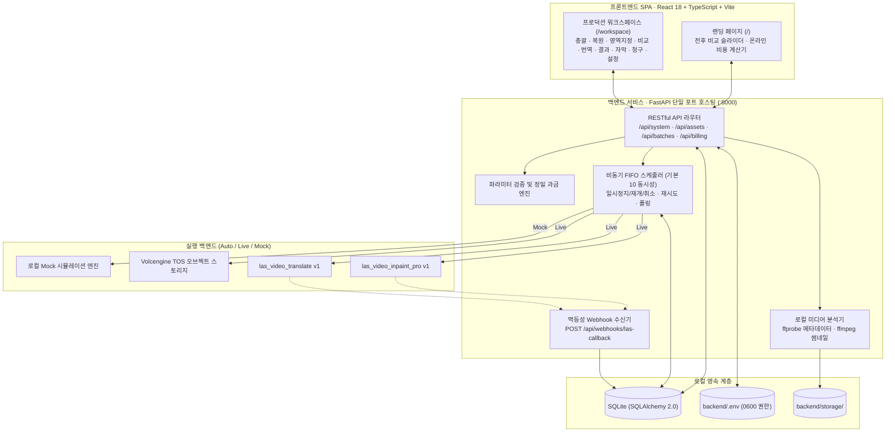

<div align="center">


# 정영 CleanFrame (净影)

**오픈소스 AI 영상 워터마크 제거 · 하드자막 흔적 없는 삭제 · 31개국어 음성 복제 더빙 및 자막 번인 통합 스튜디오**

*Open-Source AI Video Watermark Remover, Hardcoded Subtitle Eraser & 31-Language Video Localization Studio*

[](https://erasevid.com/?utm_source=github&utm_medium=readme_ko)
[](https://www.python.org/)
[](https://fastapi.tiangolo.com/)
[](https://react.dev/)
[](https://www.typescriptlang.org/)
[](https://www.volcengine.com/)
[](#5분-빠른-시작)
[](https://github.com/xuliang2024/video-watermark-remover/stargazers)

<p align="center">
  <a href="../../README.md">简体中文</a> ·
  <a href="./README.en.md">English</a> ·
  <a href="./README.ja.md">日本語</a> ·
  <strong>한국어</strong> ·
  <a href="./README.es.md">Español</a> ·
  <a href="./README.ru.md">Русский</a>
</p>

<p align="center">
  <a href="#프로젝트-소개">소개</a> ·
  <a href="#핵심-기능">핵심 기능</a> ·
  <a href="#화면-및-결과-미리보기">화면 미리보기</a> ·
  <a href="#시스템-아키텍처">아키텍처</a> ·
  <a href="#5분-빠른-시작">빠른 시작</a> ·
  <a href="#환경-변수-전체-가이드-19개-항목">환경 변수</a> ·
  <a href="#연산자-사양-및-과금-공식">지원 언어·요금</a> ·
  <a href="#rest-api-요약">REST API</a> ·
  <a href="#자주-묻는-질문-faq">FAQ</a>
</p>

> **두 가지 사용 방식, 같은 코드베이스**
>
> - **셀프 호스팅**: 저장소를 받은 뒤 `docker compose up -d`(또는 `./start.sh`)로 실행합니다. Apache-2.0, 원본과 결과물이 서버 밖으로 나가지 않습니다. Volcengine LAS / TOS 자격 증명은 직접 준비해야 합니다.
> - **호스팅 버전**: [erasevid.com](https://erasevid.com/?utm_source=github&utm_medium=readme_ko) —— 서버 불필요, 플랫폼 일괄 과금, 사용량 기반. 실패한 작업은 자동 환불됩니다.


</div>

---

## 프로젝트 소개

**CleanFrame(정영/净影)** 은 **숏폼 드라마 글로벌 배급팀, 크로스보더 이커머스 셀러, MCN 에이전시, 온라인 교육팀 및 영상 크리에이터**를 위해 설계된 오픈소스 대량 영상 복원 및 다국어 현지화 워크스페이스입니다. **FastAPI + React 18 + TypeScript** 기반으로 시공간 AI 비디오 인페인팅·번역 연산자(`las_video_inpaint_pro v1` 워터마크·하드자막 인페인팅 및 `las_video_translate v1` 31개국어 음색 복제 더빙·자막 번인)와 연동되어, **로컬 영상 일괄 업로드, 1000×1000 정규화 캔버스 영역 지정, TikTok · YouTube · Sora · 방송 로고 등 영상 워터마크 및 내장 하드자막(Hardsub) 무흔적 제거부터 31개국어 원어민 음색 복제 더빙 및 자막 재합성**까지 하나의 다크모드 스튜디오에서 원스톱으로 처리합니다.

> **API 키 없이 즉시 체험 가능 (Local Mock 모드)**: 클라우드 계정이 없어도 저장소를 클론한 뒤 `./start.sh`만 실행하면 **로컬 전 구간 시뮬레이션 모드**가 자동 활성화됩니다. 박스 라벨링, 복원 전후 슬라이더 비교, 다국어 자막 대조표, 배치 제어, 실시간 비용 계산기까지 100% 오프라인으로 체험할 수 있으며, `/workspace#settings`에서 Volcengine LAS / TOS 키를 입력하면 코드 수정 없이 즉시 `Live` 프로덕션 모드로 전환됩니다.

### 왜 CleanFrame인가요?

| 기존 영상 워터마크 제거 및 현지화 방식 | CleanFrame 올인원 스튜디오 파이프라인 |
| :--- | :--- |
| 편집 프로그램에서 매 회차마다 블러 처리나 화면 크롭을 수작업으로 반복해 구도 훼손 | **시공간 AI 인페인팅 복원**으로 움직이는 로고, 방송사 워터마크, 하단 하드자막을 배경 결 그대로 복원하고 원본 오디오 100% 보존 |
| 80~120부작 숏드라마의 동일한 우측 상단 로고를 매 화마다 반복 마스킹 | **1000×1000 정규화 영역 템플릿**에 다중 박스 + 시작·종료 구간을 저장하여 전 회차에 원클릭 일괄 적용 |
| 자막 제거, 번역, TTS 더빙, 자막 인코딩을 4~5개 툴로 옮겨 다니며 재인코딩 | **「워터마크·원본 자막 선제거 → 31개국어 더빙·자막 번인」 단일 파이프라인 연결**, 클린 마스터 1본을 전 언어가 공유 |
| 50/60fps 고프레임 영상을 그대로 API에 제출해 예상보다 2배 높은 비용 청구 | **제출 전 파일별 정밀 요금 산출 + 고프레임 자동 경고**, 30fps 상한 설정으로 비용 즉시 50% 절감 |

---

## 핵심 기능

### 1. AI 영상 워터마크 및 하드자막 무흔적 제거 (`las_video_inpaint_pro v1`)
- **4가지 제거 대상 자유 조합**: `워터마크 / 코너 로고`, `일반 하단 자막`, `스크롤 자막(티커)`, `에피소드 타이틀 정보`를 직교 조합으로 선택.
- **3가지 정밀 탐지 모드**:
  - **프로 · 정밀 인식 (`precise`)**: 비전-언어 모델(VLM) 기반으로 반투명 로고, 유동적 워터마크, 장식 폰트 자막까지 정밀 제거.
  - **프로 / 라이트 · 표준 탐지 (`standard_*`)**: 일반 하드자막 대량 제거에 최적화 (라이트 모드 분당 `¥0.50`부터).
  - **수동 고정 영역 지정 (`fixed_bboxes`)**: `1000×1000` 정규화 캔버스에 직접 박스를 그리고 초 단위 활성 시간대(예: `0.5s~62.0s` 로고, `62.0s~끝` 자막)를 지정하여 오탐지 제로 달성.
- **원본 자막 보호 (`subtitle_protect`)**: 대사 자막은 그대로 유지한 채 코너 워터마크만 깔끔하게 제거.
- **최대 4K 해상도 · 파일당 3시간 지원**: H.264 / H.265 코덱 및 720p / 1080p / 4K 출력 상한 지원.

### 2. 31개국어 영상 번역, 1:1 음색 복제 더빙 및 자막 번인 (`las_video_translate v1`)
- **25개 원본 언어 인식 → 31개 타깃 언어 동시 출력**: 한국어, 영어, 일본어, 중국어, 스페인어, 인도네시아어, 포르투갈어, 프랑스어, 독일어, 태국어, 베트남어, 아랍어, 러시아어 등 지원.
- **원화자 음색·감정 1:1 복제**: 표준 음색 복제(`¥1.50/분`) 및 고품질 더빙(`¥4.00/분`, 고속 모드 지원) 제공, `enable_dynamic_duration`으로 번역 대사 길이에 맞춘 자연스러운 싱크 정렬 지원.
- **언어별 전용 폰트 자동 매칭 및 실시간 자막 스타일러**: `NotoSansKR`, `NotoSansJP`, `NotoSansArabic` 등을 자동 매칭하며 16:9 프리뷰에서 크기·외곽선·배경 투명도·여백을 실시간 조정하고 `.srt` + `.ass` 자막 ZIP 패키지를 일괄 다운로드.

### 3. 배치 스케줄링 및 시각적 환경 설정 센터
- **로컬 미디어 자동 분석**: 업로드 시 `ffprobe` / `ffmpeg`로 해상도, FPS, 재생 시간, 첫 프레임 썸네일 자동 추출.
- **10 동시성 비동기 FIFO 큐 & 멱등성 Webhook**: 주기적 폴링과 `/api/webhooks/las-callback` 콜백을 동시 지원하며 배치 일시정지·재개·취소 및 개별 실패 태스크 재시도 제공.
- **19개 환경 변수 웹 관리 센터**: 저장 전 LAS / TOS 연결 테스트, 시크릿 마스킹 표시, SQLite(`system_settings`) 및 `backend/.env`(`0600` 권한) 이중 원자적 저장, `⌘K` / `Ctrl+K` 커맨드 팔레트 지원.

---

## 화면 및 결과 미리보기

### 1. 워터마크 · 하드자막 복원 전후 픽셀 단위 슬라이더 비교
브라우저에서 중앙 핸들을 좌우로 드래그하여 우측 상단 로고, 좌측 상단 회차 배지, 하단 하드자막이 복원된 품질을 즉시 비교합니다:

<p align="center">
  
</p>

### 2. 1000×1000 정규화 캔버스 영역 지정 및 멀티트랙 타임라인
화면 위에 여러 개의 색상 박스를 그리고 하단 타임라인에서 초 단위 구간을 지정한 뒤 템플릿으로 저장해 전체 시즌에 재사용합니다:

<p align="center">
  
</p>

### 3. 31개국어 번역 결과물 동시 프리뷰 및 타임코드 자막 대조표
영어(`en-US`), 일본어(`ja-JP`), 한국어(`ko-KR`) 결과 영상을 한 화면에서 비교하고 자막 행을 클릭해 프레임을 연동 확인하며 `.srt`/`.ass` 자막과 함께 일괄 다운로드합니다:

<p align="center">
  
</p>

### 4. 프로덕션 워크스페이스 주요 화면 (2×2 갤러리)

<table>
  <tr>
    <td width="50%" valign="top">
      
      <p align="center"><strong>작업 총괄 및 동시성 큐 모니터링</strong><br/><sub>실시간 큐 상태, 월간 쿼터 진행률, 5단계 상태 필터 및 배치 상세 관리</sub></p>
    </td>
    <td width="50%" valign="top">
      
      <p align="center"><strong>대량 워터마크 제거 배치 생성</strong><br/><sub>다중 파일 드래그 업로드, 고프레임 비용 절감 알림, 제출 전 정밀 요금 계산</sub></p>
    </td>
  </tr>
  <tr>
    <td width="50%" valign="top">
      
      <p align="center"><strong>실시간 번인 자막 스타일 스튜디오</strong><br/><sub>16:9 실시간 프리뷰, 시네마 프리셋, 폰트·외곽선·배경·여백 세밀 조정</sub></p>
    </td>
    <td width="50%" valign="top">
      
      <p align="center"><strong>투명한 종량제 단가표 & 실시간 비용 계산기</strong><br/><sub>회차 수, 분량, 해상도, 타깃 언어 수를 조절해 전체 시즌 예산 즉시 산출</sub></p>
    </td>
  </tr>
</table>

### 5. 첫 실행 온보딩 가이드 및 시스템 환경 설정 센터

<table>
  <tr>
    <td width="50%" valign="top">
      
      <p align="center"><strong>첫 실행 온보딩 마법사</strong><br/><sub>원클릭 로컬 Mock 체험 시작 또는 클라우드 인증 설정으로 바로 이동</sub></p>
    </td>
    <td width="50%" valign="top">
      
      <p align="center"><strong>19개 환경 변수 통합 관리 & 연결 테스트</strong><br/><sub>키 자동 마스킹, 저장 전 LAS/TOS 연결 검증, SQLite/.env 이중 영속화</sub></p>
    </td>
  </tr>
</table>

---

## 시스템 아키텍처



---

## 5분 빠른 시작

### Docker로 실행 (권장, 의존성 없음)

Docker와 Docker Compose만 있으면 됩니다. Python·Node.js·FFmpeg를 따로 설치할 필요가 없습니다(이미지에 포함).

```bash
git clone https://github.com/xuliang2024/video-watermark-remover.git
cd video-watermark-remover
docker compose up -d
```

데이터는 호스트의 `./data`에 저장됩니다. 자세한 내용은 [README.en.md](./README.en.md#option-1-docker-compose-recommended-zero-dependencies)를 참고하세요.

```bash
# 1. 저장소 클론
git clone https://github.com/xuliang2024/video-watermark-remover.git
cd video-watermark-remover

# 2. Python 백엔드 의존성 설치 (Python 3.10+ 필요)
python3 -m venv .venv
source .venv/bin/activate
pip install -r backend/requirements.txt

# 3. 프론트엔드 의존성 설치 (Node.js 18+ 필요)
npm --prefix frontend install

# 4. 원클릭 빌드 및 FastAPI 단일 포트 서버 실행 (http://127.0.0.1:8000)
./start.sh
```

접속 주소:
- **제품 홈**: `http://127.0.0.1:8000/`
- **프로덕션 스튜디오**: `http://127.0.0.1:8000/workspace`
- **시스템 환경 설정**: `http://127.0.0.1:8000/workspace#settings`
- **Swagger API 문서**: `http://127.0.0.1:8000/docs`

---

## 환경 변수 전체 가이드 (19개 항목)

| 그룹 | 변수명 | 기본값 | 핫 리로드 | 설명 |
| :--- | :--- | :--- | :---: | :--- |
| **1. 실행 모드** | `CLEANFRAME_EXECUTION_MODE` | `auto` | 예 | `auto` (키 유무에 따라 `live`/`mock` 자동 전환) / `live` / `mock` |
| | `CLEANFRAME_PUBLIC_BASE_URL` | `http://127.0.0.1:8000` | 예 | 외부 접근 기준 URL |
| | `CLEANFRAME_MONTHLY_QUOTA_MIN` | `3000.0` | 예 | 월간 기준 쿼터(분) |
| **2. Volcengine LAS** | `LAS_API_KEY` | *(비어 있음)* | 예 | Volcengine LAS API Key |
| | `LAS_REGION` | `cn-beijing` | 예 | `cn-beijing` / `cn-shanghai` / `cn-guangzhou` |
| | `LAS_BASE_URL` | *(자동 계산)* | 예 | 비워두면 리전별 기본 엔드포인트 사용 |
| | `LAS_CALLBACK_URL` | *(비어 있음)* | 예 | 선택적 공인 HTTPS Webhook 주소 |
| **3. Volcengine TOS** | `TOS_BUCKET` | *(비어 있음)* | 예 | LAS와 동일 리전의 TOS 버킷명 |
| | `TOS_REGION` | `cn-beijing` | 예 | TOS 리전 |
| | `TOS_ENDPOINT` | `tos-cn-beijing.volces.com` | 예 | TOS 엔드포인트 |
| | `TOS_INPUT_PREFIX` | `cleanframe/inputs` | 예 | 원본 영상 업로드 프리픽스 |
| | `TOS_OUTPUT_PREFIX` | `cleanframe/outputs` | 예 | 결과물 저장 프리픽스 |
| | `VOLC_ACCESS_KEY_ID` | *(비어 있음)* | 예 | Volcengine Access Key ID |
| | `VOLC_ACCESS_KEY_SECRET` | *(비어 있음)* | 예 | Volcengine Secret Access Key |
| **4. 스케줄러** | `CLEANFRAME_SCHEDULER_ENABLED` | `true` | 예 | 백그라운드 스케줄러 활성화 여부 |
| | `CLEANFRAME_MAX_CONCURRENCY` | `10` | 예 | 최대 병렬 작업 수 |
| | `CLEANFRAME_POLL_INTERVAL` | `3.0` | 예 | 상태 폴링 주기(초) |
| **5. DB 및 스토리지** | `CLEANFRAME_DATABASE_URL` | `sqlite:///./storage/cleanframe.db` | 재시작 필요 | SQLAlchemy DB URL |
| | `CLEANFRAME_STORAGE_DIR` | `./storage` | 재시작 필요 | 로컬 미디어 저장 경로 |

---

## 연산자 사양 및 과금 공식

- **영상 복원 (`las_video_inpaint_pro v1`)**: `비용 = 단가 × (출력 분수 × FPS 계수 × 해상도 계수)`
  - 단가: 라이트 `¥0.50/분`, 프로 표준 `¥1.50/분`, 프로 정밀 `¥3.00/분`
  - FPS 계수: `≤24fps` `0.8x`, `24~30fps` `1.0x`, `>30fps` `⌈fps/30⌉` (60fps를 30fps로 제한 시 비용 50% 절감)
  - 해상도 계수: 프로 기준 `720p` `0.6x`, `1080p` `1.0x`, `4K` `2.0x`
- **다국어 번역 (`las_video_translate v1`)**: `비용 = 단가 × 입력 분수 × 타깃 언어 수`
  - 단가: 표준 음색 복제 `¥1.50/분/언어`, 고품질 더빙 `¥4.00/분/언어`
  - **지원 언어**: 25개 원본 언어 인식 → 31개 타깃 언어 출력 (`ko-KR`, `en-US`, `ja-JP`, `zh-CN`, `yue-CN`, `es-MX`, `id-ID`, `pt-BR`, `fr-FR`, `de-DE`, `th-TH`, `vi-VN`, `ar-SA`, `ru-RU` 외).

---

## REST API 요약

서버 실행 후 `http://127.0.0.1:8000/docs`에서 전체 스키마를 테스트할 수 있습니다:
- `GET / PUT /api/system/config` · `POST /api/system/test-connection`: 환경 설정 조회/저장 및 연결 검증
- `POST /api/assets/upload`: 로컬 영상 업로드 및 `ffprobe`/`ffmpeg` 자동 분석
- `POST /api/estimates/{inpaint|translate}`: 배치 제출 전 정밀 요금 산출
- `POST /api/batches/{inpaint|translate}`: 워터마크 제거 및 다국어 번역 배치 큐 등록
- `GET /api/tasks/{id}/download-captions`: 다국어 `.srt` / `.ass` 자막 ZIP 다운로드

```bash
# 자동화 테스트 및 프로덕션 빌드 검증
pytest backend/tests/test_cleanframe.py -q
npm --prefix frontend run build
```

---

## 자주 묻는 질문 (FAQ)

**Q1: 클라우드 API 키가 없어도 모든 기능을 테스트할 수 있나요?**
네. 기본 `auto` 모드에서는 API 키가 없을 때 내장 `Mock` 시뮬레이터가 자동으로 동작하여 오프라인에서도 업로드, 박스 라벨링, 배치 실행, 전후 비교, 자막 다운로드 전 과정을 체험할 수 있습니다.

**Q2: 원본 대사 자막은 남기고 우측 상단 방송 로고만 지우려면 어떻게 하나요?**
「로고만 제거 · 자막 보호」 프리셋(`subtitle_protect=true`)을 선택하거나, 「영역 지정」 화면에서 로고 위치에만 고정 박스를 그려 템플릿으로 적용하면 박스 바깥 영역은 전혀 건드리지 않습니다.

---

<div align="center">

**CleanFrame**이 도움이 되셨다면 우측 상단 **Star**를 눌러 프로젝트를 응원해 주세요!

**[맨 위로 이동](#정영-cleanframe-净影)**

</div>
