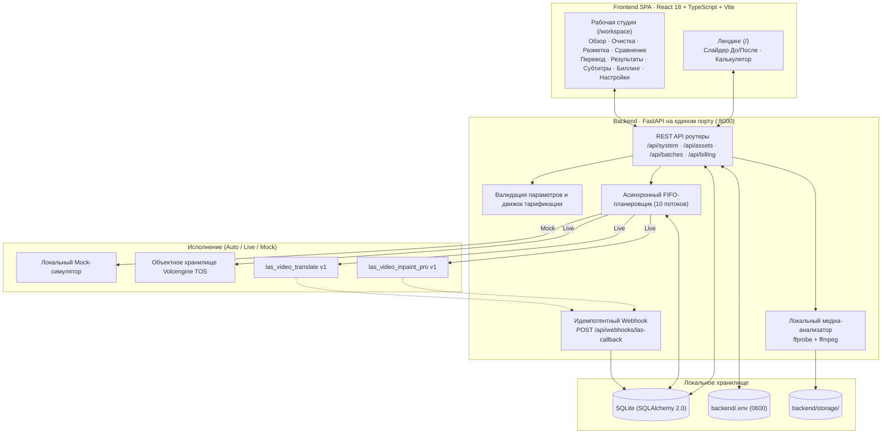

<div align="center">


# CleanFrame (净影)

**Open-Source ИИ-студия для удаления водяных знаков с видео, стирания вшитых субтитров и дубляжа/перевода на 31 язык**

[](https://erasevid.com/?utm_source=github&utm_medium=readme_ru)
[](https://www.python.org/)
[](https://fastapi.tiangolo.com/)
[](https://react.dev/)
[](https://www.typescriptlang.org/)
[](https://www.volcengine.com/)
[](#быстрый-старт-за-5-минут)
[](https://github.com/xuliang2024/video-watermark-remover/stargazers)

<p align="center">
  <a href="../../README.md">简体中文</a> ·
  <a href="./README.en.md">English</a> ·
  <a href="./README.ja.md">日本語</a> ·
  <a href="./README.ko.md">한국어</a> ·
  <a href="./README.es.md">Español</a> ·
  <strong>Русский</strong>
</p>

<p align="center">
  <a href="https://erasevid.com/?utm_source=github&utm_medium=readme_ru"><strong>🚀 Облачная SaaS-студия (EraseVid.com · Без установки)</strong></a> ·
  <a href="#о-проекте">О проекте</a> ·
  <a href="#ключевые-возможности">Возможности</a> ·
  <a href="#галерея-интерфейса-и-результатов">Скриншоты</a> ·
  <a href="#архитектура-системы">Архитектура</a> ·
  <a href="#быстрый-старт-за-5-минут">Быстрый старт</a> ·
  <a href="#переменные-окружения-19-параметров">Конфигурация</a> ·
  <a href="#операторы-языки-и-формулы-тарификации">Языки и тарифы</a> ·
  <a href="#справочник-rest-api">REST API</a> ·
  <a href="#частые-вопросы-faq">FAQ</a>
</p>

> **Хотите работать сразу без настройки серверов и облачных API-ключей?** Переходите в официальную облачную студию 👉 **[https://erasevid.com](https://erasevid.com/?utm_source=github&utm_medium=readme_ru)** — пакетная загрузка в браузере, командный доступ, оплата по факту с автовозвратом при сбоях и приветственный бонус при регистрации.


</div>

---

## О проекте

**CleanFrame (净影)** — это профессиональная open-source студия пакетной постобработки и локализации видео для **дистрибьюторов коротких драм (short dramas), селлеров маркетплейсов (Ozon, Wildberries, TikTok Shop, Shopee), MCN-агентств, образовательных платформ и авторов контента**. Система построена на стеке **FastAPI + React 18 + TypeScript** с интеграцией ИИ-операторов (`las_video_inpaint_pro v1` для бесшовного удаления водяных знаков с видео — TikTok, YouTube, Reels, Sora, Runway, ТВ-логотипов — и вшитых субтитров / хардсаба, `las_video_translate v1` для дубляжа с клонированием голоса и вшивания субтитров на 31 языке), объединяя **пакетную загрузку, разметку областей 1000×1000, ИИ-очистку видео и многоязычный перевод/дубляж** в едином тёмном рабочем пространстве.

> **Мгновенный запуск без API-ключей (`Local Mock Mode`)**: Для знакомства с системой облачные ключи не требуются. Клонируйте репозиторий и запустите `./start.sh` — автоматически включится **полнофункциональный локальный симулятор** с интерактивной разметкой рамок, слайдером «до/после», таблицей субтитров и калькулятором стоимости. Для перехода в боевой режим достаточно указать ключи Volcengine LAS / TOS на странице `/workspace#settings` без перезапуска и правки кода.

### Какие задачи решает CleanFrame?

| Традиционный процесс очистки и локализации видео | Единый конвейер CleanFrame |
| :--- | :--- |
| Ручное размытие или обрезка кадра в видеоредакторе для каждой серии с потерей композиции | **Пространственно-временной ИИ-инпейнтинг** бесшовно восстанавливает фон под логотипами, плашками и вшитыми субтитрами, на 100% сохраняя исходный звук |
| Повторная ручная обводка одного и того же углового логотипа в 80–120 сериях сезона | **Нормализованные шаблоны областей 1000×1000** с таймкодами начала и конца применяются ко всему сезону в один клик |
| Перенос файлов между 4–5 разными сервисами для очистки текста, перевода, озвучки и хардсаба | **Сквозной пайплайн «Очистка водяных знаков -> Дубляж и субтитры на 31 языке»** с общим чистым мастер-файлом |
| Отправка исходников 50/60fps напрямую в облако с двукратной переплатой | **Пофайловый предрасчёт стоимости + автопредупреждение о высоком FPS** (ограничение до 30fps экономит 50% бюджета) |

---

## Ключевые возможности

### 1. Бесшовное удаление водяных знаков и вшитых субтитров (`las_video_inpaint_pro v1`)
- **Гибкий выбор целей очистки**: `Водяные знаки / Логотипы`, `Обычные субтитры`, `Бегущая строка`, `Титры эпизода`.
- **Три режима локализации**:
  - **Pro · Точное распознавание VLM (`precise`)**: Мультимодальное обнаружение полупрозрачных телелоготипов, плавающих водяных знаков и декоративных шрифтов.
  - **Pro / Lite · Стандартная детекция (`standard_*`)**: Быстрая пакетная очистка стандартных субтитров (от `¥0.50 / мин` в режиме Lite).
  - **Ручные фиксированные рамки (`fixed_bboxes`)**: Рисование нескольких цветовых прямоугольников на холсте `1000×1000` с точными интервалами времени на многодорожечном таймлайне — ноль ложных срабатываний.
- **Умная защита субтитров (`subtitle_protect`)**: Удаление углового логотипа при полном сохранении оригинальных диалоговых субтитров.
- **Поддержка до 4K и до 3 часов на файл**: Кодеки H.264 / H.265 и лимиты разрешения 720p / 1080p / 4K.

### 2. Перевод видео на 31 язык, клонирование голоса 1:1 и вшивание субтитров (`las_video_translate v1`)
- **25 исходных языков -> 31 целевой язык**: Русский (`ru-RU`), Английский (`en-US`), Китайский, Японский, Корейский, Испанский, Португальский, Французский, Немецкий, Турецкий, Арабский, Индонезийский, Тайский, Вьетнамский и др.
- **Клонирование тембра и эмоций диктора 1:1**: Стандартный режим (`¥1.50 / мин`) и высококачественный дубляж (`¥4.00 / мин`, с поддержкой `enable_fast_mode`) + динамическое выравнивание длительности фраз (`enable_dynamic_duration`).
- **Визуальный конструктор субтитров**: Автоподбор шрифтов семейства `NotoSans` под письменность языка, превью 16:9 в реальном времени (кегль, обводка, подложка, отступы) и скачивание архива `.zip` с `.srt` + `.ass`.

### 3. Пакетный планировщик на 10 потоков и веб-центр настроек
- **Локальный медиа-инспектор**: Автоматическое извлечение метаданных и превью первого кадра через `ffprobe` и `ffmpeg`.
- **Асинхронная FIFO-очередь (10 задач параллельно) + идемпотентный Webhook**: Активный опрос статуса и приём уведомлений на `/api/webhooks/las-callback`; пауза, возобновление, отмена батчей и повтор отдельных задач.
- **Веб-панель всех 19 переменных + Палитра команд (`⌘K` / `Ctrl+K`)**: Проверка соединения с LAS/TOS до сохранения и двойная атомарная запись в SQLite и `backend/.env` (`0600`).

---

## Галерея интерфейса и результатов

### 1. Попиксельное сравнение «До / После» очистки водяных знаков и хардсаба
<p align="center">
  
</p>

### 2. Разметка областей на холсте 1000×1000 и многодорожечный таймлайн
<p align="center">
  
</p>

### 3. Готовые видео на 31 языке и синхронизированная таблица субтитров
<p align="center">
  
</p>

### 4. Основные экраны рабочей студии (сетка 2×2)

<table>
  <tr>
    <td width="50%" valign="top">
      
      <p align="center"><strong>Обзор задач и мониторинг очереди</strong><br/><sub>Загрузка пула параллельности, месячная квота и фильтрация по 5 статусам</sub></p>
    </td>
    <td width="50%" valign="top">
      
      <p align="center"><strong>Создание пакета удаления водяных знаков</strong><br/><sub>Пакетная загрузка, подсказка экономии на 60fps и точный расчёт цены</sub></p>
    </td>
  </tr>
  <tr>
    <td width="50%" valign="top">
      
      <p align="center"><strong>Интерактивный редактор стиля субтитров</strong><br/><sub>Живое превью 16:9, пресеты оформления, контур, фон и безопасные поля</sub></p>
    </td>
    <td width="50%" valign="top">
      
      <p align="center"><strong>Прозрачные тарифы и калькулятор бюджета</strong><br/><sub>Мгновенная оценка стоимости очистки и дубляжа целого сезона</sub></p>
    </td>
  </tr>
</table>

### 5. Мастер первого запуска и центр системных настроек

<table>
  <tr>
    <td width="50%" valign="top">
      
      <p align="center"><strong>Мастер первого запуска</strong><br/><sub>Старт в один клик в локальном Mock-режиме или переход к вводу ключей</sub></p>
    </td>
    <td width="50%" valign="top">
      
      <p align="center"><strong>Управление 19 переменными и проверка связи</strong><br/><sub>Маскирование ключей, тест LAS/TOS до сохранения и запись в SQLite + .env</sub></p>
    </td>
  </tr>
</table>

---

## Архитектура системы



---

## Быстрый старт за 5 минут

```bash
# 1. Клонировать репозиторий
git clone https://github.com/xuliang2024/video-watermark-remover.git
cd video-watermark-remover

# 2. Установить Python-зависимости бэкенда (требуется Python 3.10+)
python3 -m venv .venv
source .venv/bin/activate
pip install -r backend/requirements.txt

# 3. Установить зависимости фронтенда (требуется Node.js 18+)
npm --prefix frontend install

# 4. Собрать фронтенд и запустить единый сервер (http://127.0.0.1:8000)
./start.sh
```

Точки входа в браузере:
- **Главная страница**: `http://127.0.0.1:8000/`
- **Рабочая студия**: `http://127.0.0.1:8000/workspace`
- **Системные настройки**: `http://127.0.0.1:8000/workspace#settings`
- **Документация Swagger API**: `http://127.0.0.1:8000/docs`

---

## Переменные окружения (19 параметров)

| Группа | Переменная | По умолчанию | Горячее обновление | Описание |
| :--- | :--- | :--- | :---: | :--- |
| **1. Режим работы** | `CLEANFRAME_EXECUTION_MODE` | `auto` | Да | `auto` (`live` при наличии ключей, иначе `mock`), `live` или `mock` |
| | `CLEANFRAME_PUBLIC_BASE_URL` | `http://127.0.0.1:8000` | Да | Публичный базовый URL сервиса |
| | `CLEANFRAME_MONTHLY_QUOTA_MIN` | `3000.0` | Да | Ориентир месячного лимита в минутах |
| **2. Volcengine LAS** | `LAS_API_KEY` | *(пусто)* | Да | API-ключ консоли Volcengine LAS |
| | `LAS_REGION` | `cn-beijing` | Да | `cn-beijing` / `cn-shanghai` / `cn-guangzhou` |
| | `LAS_BASE_URL` | *(авто)* | Да | Автоматически формируется по региону |
| | `LAS_CALLBACK_URL` | *(пусто)* | Да | Опциональный публичный HTTPS URL для webhook |
| **3. Volcengine TOS** | `TOS_BUCKET` | *(пусто)* | Да | Имя бакета TOS в том же регионе, что и LAS |
| | `TOS_REGION` | `cn-beijing` | Да | Регион бакета TOS |
| | `TOS_ENDPOINT` | `tos-cn-beijing.volces.com` | Да | Эндпоинт сервиса TOS |
| | `TOS_INPUT_PREFIX` | `cleanframe/inputs` | Да | Префикс ключей для загружаемых исходников |
| | `TOS_OUTPUT_PREFIX` | `cleanframe/outputs` | Да | Префикс ключей для готовых файлов |
| | `VOLC_ACCESS_KEY_ID` | *(пусто)* | Да | Access Key ID с правами чтения/записи в бакет |
| | `VOLC_ACCESS_KEY_SECRET` | *(пусто)* | Да | Secret Access Key (права файла `0600`) |
| **4. Планировщик** | `CLEANFRAME_SCHEDULER_ENABLED` | `true` | Да | Включение фонового диспетчера задач |
| | `CLEANFRAME_MAX_CONCURRENCY` | `10` | Да | Максимум параллельных операторских задач |
| | `CLEANFRAME_POLL_INTERVAL` | `3.0` | Да | Интервал опроса статуса (сек) |
| **5. БД и диск** | `CLEANFRAME_DATABASE_URL` | `sqlite:///./storage/cleanframe.db` | Перезапуск | URL подключения SQLAlchemy |
| | `CLEANFRAME_STORAGE_DIR` | `./storage` | Перезапуск | Локальный каталог медиафайлов |

---

## Операторы, языки и формулы тарификации

- **Очистка видео (`las_video_inpaint_pro v1`)**: `Стоимость = Тариф × (Минуты_выхода × Коэф_FPS × Коэф_разрешения)`
  - Тарифы: Lite `¥0.50/мин`, Pro Стандарт `¥1.50/мин`, Pro Точный `¥3.00/мин`.
  - Коэффициент FPS: `≤24fps` `0.8x`, `24–30fps` `1.0x`, `>30fps` `⌈fps/30⌉`.
  - Коэффициент разрешения (Pro): `720p` `0.6x`, `1080p` `1.0x`, `4K` `2.0x`.
- **Многоязычный перевод (`las_video_translate v1`)**: `Стоимость = Тариф × Минуты_входа × Количество_целевых_языков`
  - Тарифы: Стандартное клонирование голоса `¥1.50/мин/язык`, Высокое качество `¥4.00/мин/язык`.
  - **Языки**: распознавание 25 исходных языков -> перевод и озвучка на 31 целевой язык (`ru-RU`, `en-US`, `zh-CN`, `ja-JP`, `ko-KR`, `es-MX`, `pt-BR`, `fr-FR`, `de-DE`, `tr-TR`, `ar-SA`, `id-ID`, `th-TH`, `vi-VN` и др.).

---

## Справочник REST API

Полная интерактивная документация OpenAPI доступна по адресу `http://127.0.0.1:8000/docs`:
- `GET / PUT /api/system/config` · `POST /api/system/test-connection`: чтение/обновление настроек и тест соединения
- `POST /api/assets/upload`: загрузка локальных видео с анализом через `ffprobe` / `ffmpeg`
- `POST /api/estimates/{inpaint|translate}`: точный расчёт стоимости до запуска пакета
- `POST /api/batches/{inpaint|translate}`: постановка пакетных задач в асинхронную очередь
- `GET /api/tasks/{id}/download-captions`: скачивание `.zip`-архива субтитров `.srt` и `.ass`

```bash
# Запуск автотестов и проверка production-сборки фронтенда
pytest backend/tests/test_cleanframe.py -q
npm --prefix frontend run build
```

---

## Частые вопросы (FAQ)

**В1: Можно ли протестировать проект без аккаунта и ключей Volcengine?**
Да. В режиме по умолчанию `CLEANFRAME_EXECUTION_MODE=auto` при отсутствии ключей автоматически запускается локальный `Mock`-движок, позволяющий полностью пройти весь сценарий офлайн.

**В2: Как удалить фиксированный логотип канала во всех сериях, не задев оригинальные субтитры?**
Выберите пресет **«Только логотип · Защита субтитров»** (`subtitle_protect=true`) либо выделите область логотипа фиксированной рамкой в разделе `/workspace#annotate` и примените шаблон ко всему пакету.

---

<div align="center">

Если **CleanFrame** оказался полезен для ваших задач очистки и локализации видео, поддержите проект звездой (**Star**) на GitHub!

**[Наверх](#cleanframe-净影)**

</div>
